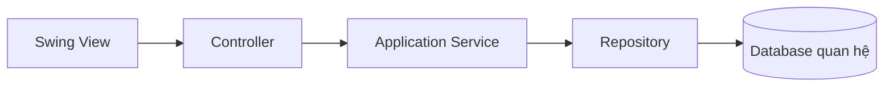
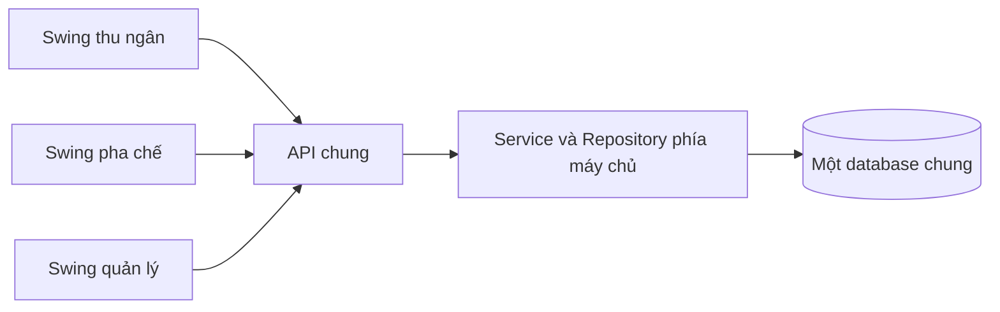

# Kiến trúc và khả năng mở rộng HomuCafe

## 🧭 Phạm vi system design

System design của dự án bao gồm ranh giới nghiệp vụ, quyền, luồng dữ liệu, tính nhất quán, khôi phục lỗi, hiệu năng, khả năng mở rộng và cách triển khai. Performance là thời gian/tài nguyên xử lý ở một tải; scalability là khả năng tiếp tục đáp ứng khi dữ liệu, người dùng hoặc máy tăng. Có thêm Redis/RabbitMQ không tự chứng minh hệ thống tốt hơn.

Định hướng hiện tại: Java Swing, một ứng dụng chia phần nghiệp vụ rõ ràng, ưu tiên transaction trong database quan hệ. Chưa chọn database hoặc backend cụ thể. Đây là kiến trúc mục tiêu; code hiện là giao diện mẫu, chưa có tầng xử lý hoàn chỉnh.

## 🏗️ Luồng xử lý bản đầu

| Thành phần | Trách nhiệm |
| --- | --- |
| View | Nhập/hiển thị, trạng thái tải/rỗng/lỗi; không tự tính số tiền quyết toán hoặc viết SQL |
| Controller | Đọc input, gọi Service, xử lý kết quả/lỗi và cập nhật View |
| Service | Quyền, trạng thái, tính tiền và transaction; không phụ thuộc JTextField/JTable |
| Repository | Đọc/ghi theo transaction do Service điều phối; không quyết định quyền bằng menu |
| Model/DTO | Dữ liệu nghiệp vụ và đầu vào/đầu ra khi cần; không bắt buộc mỗi class có một DTO giống hệt |

Database/mạng/chạy tác vụ lâu thực hiện ngoài EDT; thay đổi thành phần Swing trên EDT. Không gọi chờ tác vụ dài trên EDT. Xem [SwingWorker của JDK 21](https://docs.oracle.com/en/java/javase/21/docs/api/java.desktop/javax/swing/SwingWorker.html).

## 🗂️ Module tổng thể và package con

Bốn module là nhóm trách nhiệm logic, chưa cần bốn Maven project hoặc microservices. Giữ package theo chức năng; không di chuyển hàng loạt chỉ để làm cây thư mục đẹp. `SampleScreens` tạm gom các bố cục, tách dần khi triển khai chức năng.

| Module logic | Package con dự kiến |
| --- | --- |
| Bán hàng | `order`, `table`, `kitchen`, `payment`, `voucher` |
| Kho và thực đơn | `menu`, `inventory`, `purchasing` |
| Nhân sự và truy cập | `auth`, `staff`, `shift` |
| Quản trị và báo cáo | `customer`, `finance`, `report`, `admin` |

`app` giữ khởi động, cấu hình và điều hướng; `shared` chỉ chứa thành phần thực sự dùng chung. Không truy cập trực tiếp dữ liệu nội bộ của module khác từ View. Chốt hợp đồng Service để liên kết đơn–tiền–kho và xác định nơi sở hữu transaction. Không tạo một transaction riêng ở mỗi Repository rồi hy vọng chúng cùng thành công.

## 📊 Chọn mức tải và kiểm chứng hiệu năng

Nhóm chốt các số dưới đây trong OPEN07 trước khi xem là cam kết. Đây là bộ đo khởi điểm đề xuất, chưa được benchmark trên ứng dụng thật.

| Đo gì | Kịch bản đề xuất | Mức mục tiêu để nhóm duyệt |
| --- | --- | --- |
| Tra menu/đơn | 300 biến thể và 20.000 đơn/100.000 dòng mẫu | p95 không quá 2 giây với trang kết quả được giới hạn |
| Báo cáo | Kỳ một tháng trên cùng bộ dữ liệu | p95 không quá 5 giây; có chỉ báo tải |
| Đáp ứng UI | Trong khi truy vấn, in hoặc xuất file | Vẫn thao tác cửa sổ, không chạy tác vụ dài trên EDT |
| Ghi đồng thời | Hai yêu cầu cùng thu đơn/giữ lượng tồn cuối | Không thu trùng, không giữ vượt tồn; đúng quan trọng hơn nhanh |
| Khôi phục | Bản sao có giao dịch và sổ kho | Đọc/đối soát lại được; đo và ghi thời gian thực tế |

Báo kết quả cần ghi CPU/RAM/ổ đĩa, JDK/database, số bản ghi, số người đồng thời, điều kiện mạng, số lần đo và p95. Không ghi “chịu được 1.000 người” khi chưa đo. Ưu tiên index theo truy vấn, phân trang, giới hạn kỳ báo cáo, tránh N+1 và transaction ngắn trước khi thêm hạ tầng.

## 🌐 Mở rộng sang nhiều máy khi cần

Bản đầu một máy là hướng triển khai đề xuất, không phải quyết định đã chốt. Khi cần nhiều máy: chuyển ranh giới xử lý tin cậy lên máy chủ, thiết kế API/DTO, xác thực phiên, timeout, requestId, phiên bản bản ghi và cập nhật phiếu. Không chỉ đổi đường dẫn database hoặc chia sẻ file qua thư mục mạng.

Phiếu pha chế lưu bền trong database. Màn hình đọc phiếu đã commit; lần đầu có thể dùng làm mới/polling nền có giới hạn và cơ chế dừng khi đóng màn hình. Cần tự cập nhật nhanh hơn thì cân nhắc kênh đẩy sau khi có yêu cầu cụ thể. Mất kết nối không được hiển thị đã lưu/đã thu giả. Offline nhiều máy và tự hòa giải dữ liệu chưa thuộc baseline.

## 🧩 Redis và RabbitMQ

| Công cụ | Có bắt buộc bây giờ? | Chỉ xem xét khi |
| --- | --- | --- |
| Redis | Không | Có nhu cầu cache/chia sẻ dữ liệu tạm rõ và đo được nút thắt đọc; đã có chính sách TTL, invalidation, lỗi cache và quyền |
| RabbitMQ | Không | Có nhiều tác vụ/consumer độc lập cần retry, tách thời gian xử lý hoặc tích hợp ngoài; đã chốt giao nhận, vận hành và theo dõi lỗi |

Redis có thể dùng làm cache/dữ liệu trong bộ nhớ; bản đầu vẫn dùng database làm nguồn chuẩn cho tiền, kho và chứng từ. Cache cũ không được quyết định số tiền thu hoặc tồn khả dụng. Tham khảo [Redis](https://redis.io/about/).

RabbitMQ có acknowledgement/confirm và thông điệp có thể được giao lại khi phục hồi. Nếu đưa vào, consumer phải chống xử lý trùng; cần xử lý khoảng trống giữa commit database và gửi message, chẳng hạn thiết kế outbox phù hợp. Một message queue không tự thay thế transaction tiền/kho. Tham khảo [RabbitMQ Reliability Guide](https://www.rabbitmq.com/docs/reliability).

Đề xuất hiện tại là không đưa hai dịch vụ này vào `pom.xml`, bản cài hoặc CI. Ghi nhu cầu bằng Issue, số đo và quyết định kiến trúc trước khi thêm; học công nghệ có thể làm demo riêng sau luồng cốt lõi.
