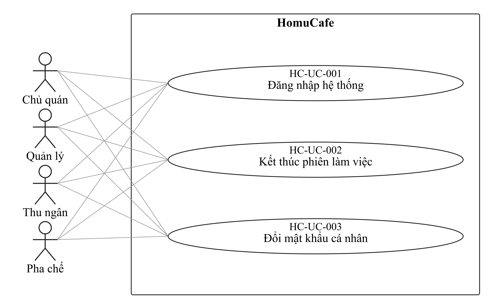
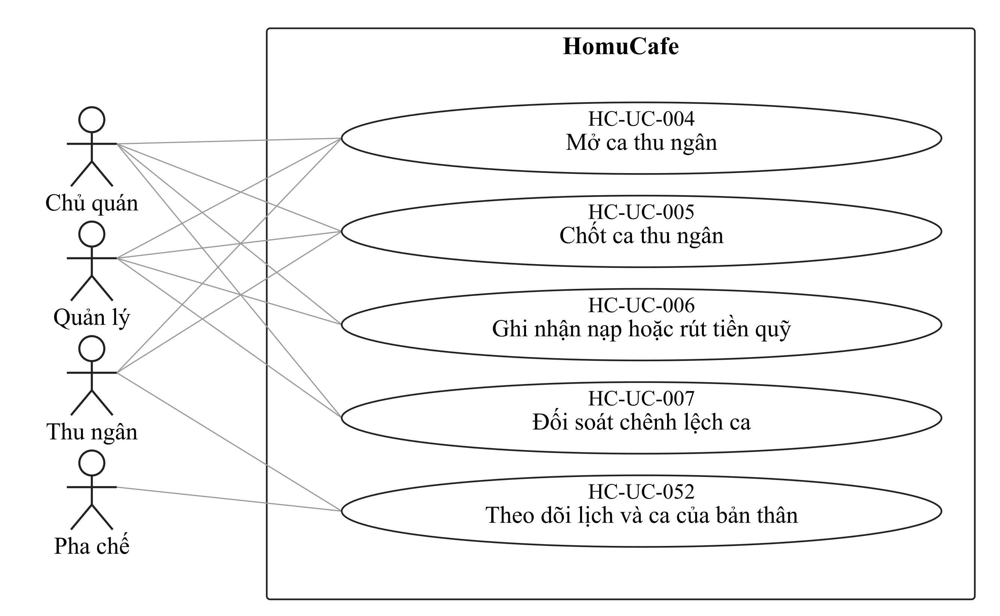
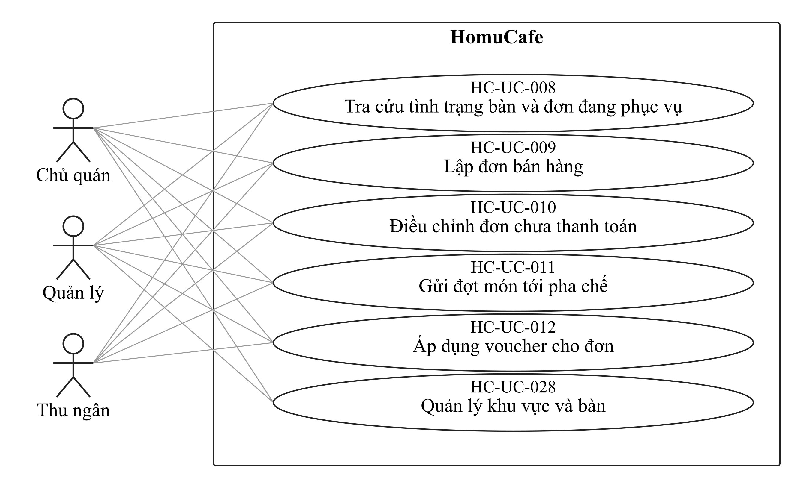
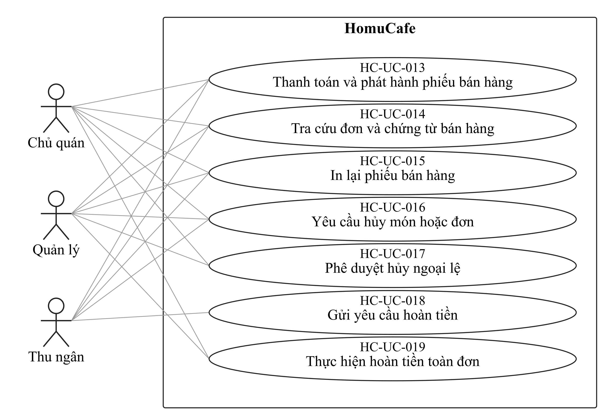
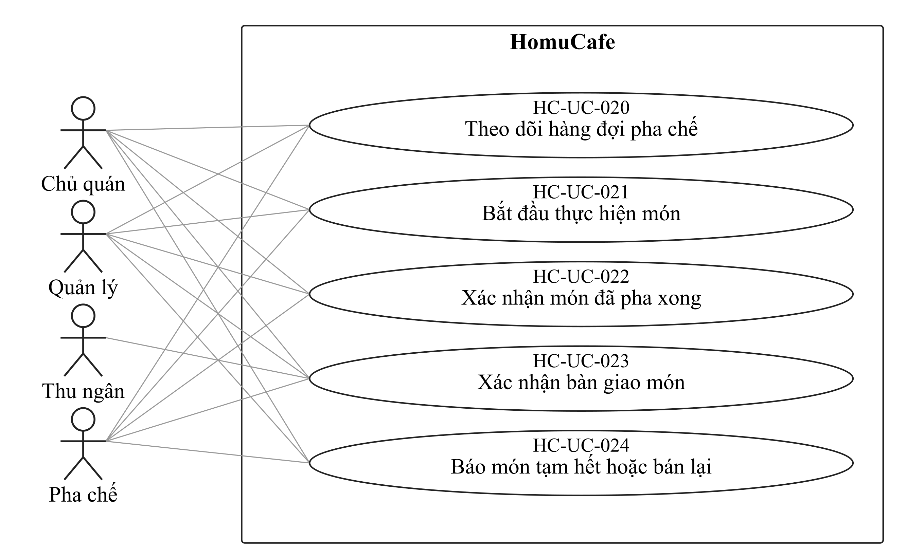
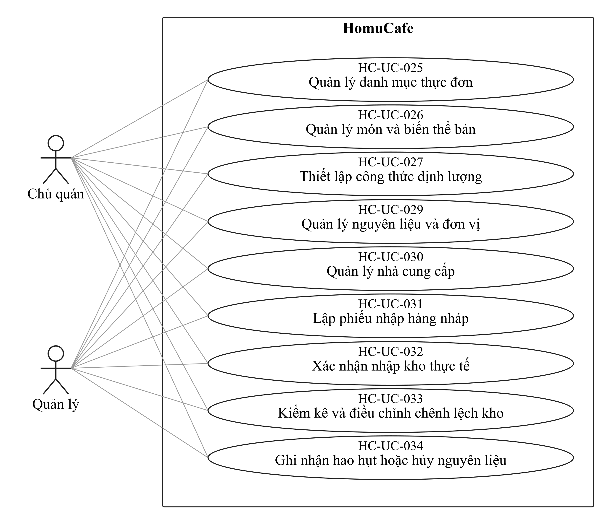
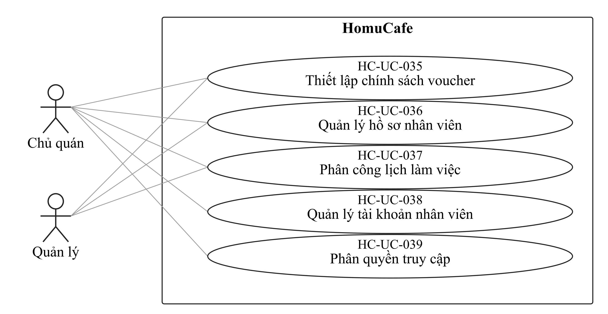
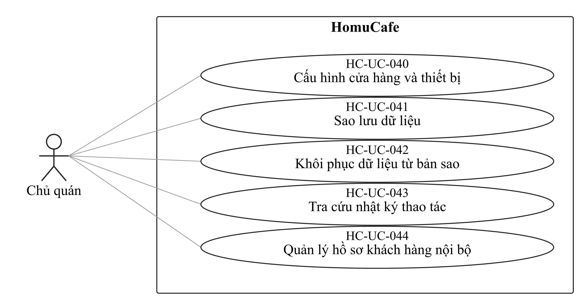
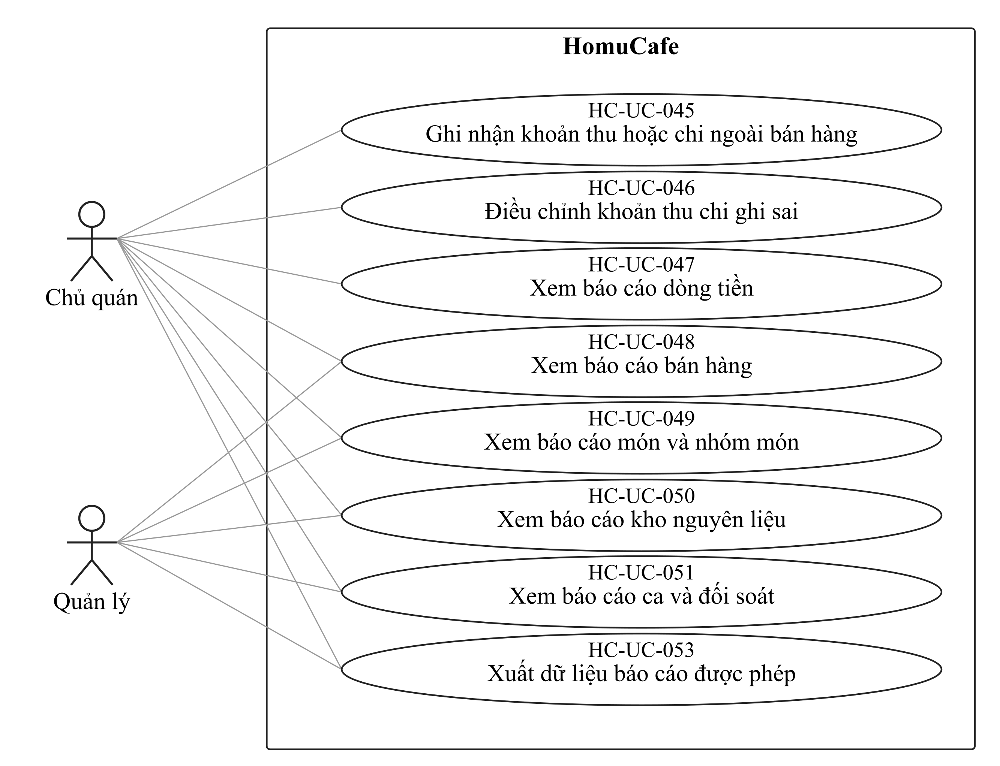

# Đặc tả use case hệ thống HomuCafe

Phiên bản đề xuất 0.3 | Ngày 21 tháng 10 năm 2026 | Phụ lục phân tích yêu cầu

## Phạm vi và cách sử dụng

Tài liệu đặc tả mục tiêu người dùng cho hệ thống desktop quản lý một quán cà phê HomuCafe. Đây là đầu vào để làm báo cáo phân tích hệ thống, rà màn hình và thiết kế dữ liệu; không phải xác nhận tính năng đã triển khai.

Phạm vi gồm bán tại bàn và mang đi, phối hợp pha chế, thanh toán ghi nhận thủ công, ca và đối soát, thực đơn, kho, nhập hàng, voucher, hồ sơ nhân viên/khách nội bộ, quyền và báo cáo. Chưa chốt mô hình một hay nhiều máy; quy tắc nghiệp vụ giữ độc lập cách triển khai.

53 use case được nhận diện ở mức mục tiêu hoặc tiểu mục tiêu có kết quả nghiệp vụ độc lập. Thêm/sửa/ngừng dùng một đối tượng thường nằm trong cùng ca quản lý; không đếm mỗi nút bấm thành một use case. Các yêu cầu và thao tác duyệt tách riêng khi khác actor, thời điểm hoặc quyền chịu trách nhiệm.

Mã HC-UC-001 đến HC-UC-053 là bộ mã mới của bản 0.3, không thay nghĩa âm thầm cho UC01–UC23 trong hồ sơ cũ. Bộ hồ sơ cũ vẫn giữ nguyên; bảng chuyển mã nằm cuối tài liệu.

P1 là thứ tự ưu tiên đề xuất cho lát cắt bán hàng; P2 là phần mở rộng quản lý cần cho phạm vi sản phẩm tổng thể. Đây chưa phải cam kết rằng cả 53 ca đều phải có trong lần phát hành đầu. Bật kho thì các quy tắc giữ và xuất kho liên quan trở thành điều kiện bắt buộc của luồng bán.

Khách mua hàng và nhà cung cấp chưa có tài khoản hoặc cổng tự phục vụ, nên là bên liên quan nghiệp vụ, không phải actor thao tác trực tiếp trong ranh giới phần mềm hiện tại. Chưa tích hợp ngân hàng hoặc cổng thanh toán tự động; máy in là thiết bị đầu ra hỗ trợ ca in.

## Actor và nguyên tắc cấp quyền

Chủ quán quản trị quyền, dữ liệu khách hàng, sổ tiền, cấu hình và sao lưu. Quản lý điều hành theo quyền được cấp, không tự cấp vai trò chủ quán. Thu ngân làm bán hàng và ca mình. Pha chế xử lý phiếu và báo tình trạng món, không xem tài chính.

Một tài khoản có thể kiêm nhiều vai trò. Bảng actor ghi các vai trò được phép tham gia khi đáp ứng điều kiện; không phải yêu cầu cả ba vai trò phải có mặt để thực hiện. Chủ quán làm nghiệp vụ thu ngân vẫn phải có ca mở và được phân công phù hợp.

Giới hạn riêng của dự án: chỉ chủ quán được xem và quản lý hồ sơ khách hàng. Quyền hồ sơ nhân viên, quyền phân lịch và quyền gán vai trò tài khoản là ba quyền khác nhau.

Mỗi use case dùng phiên đã xác thực và quyền được kiểm tra ở xử lý nghiệp vụ. Hiện code Swing mới có menu theo vai trò xem thử; các quyền dưới đây là yêu cầu thiết kế, chưa được thực thi bằng xác thực thật.

## Quy tắc chung và giới hạn bảo đảm

BR01 Một bàn có tối đa một đơn mở. Đơn tại bàn có thể pha trước thu; mang đi thu trước và tạo đợt pha chế cùng giao dịch dữ liệu. Chưa tách, gộp hoặc chuyển bàn trong baseline này.

BR02 Tách trạng thái đơn, tiền và từng món. Chỉ đóng đơn khi thu đủ và mọi món đã giao/hủy hợp lệ. Đã thu thì không sửa trực tiếp giá, lượng hoặc giảm của phiếu.

BR03 Tên, giá, nhóm món, tùy chọn và công thức cần bản chụp phù hợp. Thay danh mục không làm đổi chứng từ hoặc tiêu hao lịch sử.

BR04 Khi có kho: gửi pha chế giữ nguyên liệu; bắt đầu pha chuyển giữ thành xuất dùng một lần. Hủy trước pha giải phóng giữ; hủy/hoàn sau pha không tự nhập lại kho và không xuất hao hụt lần hai.

BR05 Một voucher/đơn, chưa cộng giảm thủ công. Kiểm tra lại lúc thu; ghi lượt cùng payment. Giới hạn dùng chung được bảo vệ khi ghi đồng thời. Hoàn toàn đơn đề xuất không tự hoàn lượt.

BR06 Tiền VND nguyên dùng BigDecimal hoặc số nguyên đồng trong nghiệp vụ thật. Một lần thu đủ một phương thức và hoàn toàn đơn tối đa một lần. Chuyển khoản chỉ thành đã thu khi người có quyền đối chiếu thực nhận.

BR07 Tiền mặt dự kiến = đầu ca + thu mặt − hoàn mặt + nạp quỹ − rút/nộp quỹ. Chuyển khoản, tiền đầu ca và chuyển nội bộ không phải cùng loại chỉ tiêu với doanh thu.

BR08 Mỗi thao tác ghi quan trọng có requestId và kiểm tra phiên bản. Cùng mã và nội dung trả kết quả cũ; cùng mã khác nội dung bị từ chối. Khóa/ràng buộc dữ liệu còn chặn hai requestId khác nhau cùng thu một đơn.

BR09 Ghi các thay đổi liên quan trong transaction. Lỗi trước commit không được để dữ liệu một phần. Khi chưa rõ kết quả, tra theo requestId; không tự báo thất bại rồi thực hiện lần mới.

BR10 Thanh toán hoặc hoàn có tiền thực bên ngoài không thể được database tự rollback. Nếu tiền thực đã giao nhưng chưa xác định bản ghi, phải đối chiếu; không tự thu/trả thêm. Lỗi máy in sau commit không đảo payment.

BR11 Thời điểm và người thao tác do tầng xử lý tin cậy xác định. Báo cáo tiền thu dùng ngày thực thu, tiền hoàn dùng ngày thực hoàn; kỳ đầu bao gồm và cuối loại trừ theo múi giờ quán.

BR12 Dữ liệu danh mục đã có lịch sử thì ngừng dùng thay vì xóa. Nhật ký không chứa mật khẩu/token. Sổ tiền, phiếu, sổ kho và ca đã xác nhận không được sửa đè để che lịch sử.

BR13 Tiền thu sau hoàn chưa phải lợi nhuận. Nhập kho chưa chắc đã trả tiền; khoản trả nhà cung cấp cần liên kết nhưng không tự sinh chi từ phiếu nháp hoặc từ giá trị tồn.

BR14 Kiểm tra quyền khi đọc, ghi và tra kết quả lặp; ẩn nút chỉ hỗ trợ giao diện. Khi nhiều máy cần thêm xác thực từ xa, kiểm soát đồng thời và cập nhật dữ liệu chung.

BR15 Không có dữ liệu thật thì hiển thị rỗng/đang tải/lỗi đúng nghĩa, không lấy số minh họa làm kết quả nghiệp vụ. Dữ liệu mẫu và chức năng chưa nối phải được ghi rõ.

## Danh mục use case theo actor

Ký hiệu C là được phép thực hiện trong phạm vi và điều kiện nêu ở đặc tả. Ô trống là không được cấp mặc định. Tài khoản kiêm nhiệm chỉ được hành động trong quyền đã gán. Use case không bị nhân bản khi có nhiều actor cùng được phép.

| Mã và mục tiêu | Chủ quán | Quản lý | Thu ngân | Pha chế |
| --- | --- | --- | --- | --- |
| HC-UC-001 Đăng nhập hệ thống | C | C | C | C |
| HC-UC-002 Kết thúc phiên làm việc | C | C | C | C |
| HC-UC-003 Đổi mật khẩu cá nhân | C | C | C | C |
| HC-UC-004 Mở ca thu ngân | C | C | C | — |
| HC-UC-005 Chốt ca thu ngân | C | C | C | — |
| HC-UC-006 Ghi nhận nạp hoặc rút tiền quỹ | C | C | — | — |
| HC-UC-007 Đối soát chênh lệch ca | C | C | — | — |
| HC-UC-008 Tra cứu tình trạng bàn và đơn đang phục vụ | C | C | C | — |
| HC-UC-009 Lập đơn bán hàng | C | C | C | — |
| HC-UC-010 Điều chỉnh đơn chưa thanh toán | C | C | C | — |
| HC-UC-011 Gửi đợt món tới pha chế | C | C | C | — |
| HC-UC-012 Áp dụng voucher cho đơn | C | C | C | — |
| HC-UC-013 Thanh toán và phát hành phiếu bán hàng | C | C | C | — |
| HC-UC-014 Tra cứu đơn và chứng từ bán hàng | C | C | C | — |
| HC-UC-015 In lại phiếu bán hàng | C | C | C | — |
| HC-UC-016 Yêu cầu hủy món hoặc đơn | C | C | C | — |
| HC-UC-017 Phê duyệt hủy ngoại lệ | C | C | — | — |
| HC-UC-018 Gửi yêu cầu hoàn tiền | — | — | C | — |
| HC-UC-019 Thực hiện hoàn tiền toàn đơn | C | C | — | — |
| HC-UC-020 Theo dõi hàng đợi pha chế | C | C | — | C |
| HC-UC-021 Bắt đầu thực hiện món | C | C | — | C |
| HC-UC-022 Xác nhận món đã pha xong | C | C | — | C |
| HC-UC-023 Xác nhận bàn giao món | C | C | C | C |
| HC-UC-024 Báo món tạm hết hoặc bán lại | C | C | — | C |
| HC-UC-025 Quản lý danh mục thực đơn | C | C | — | — |
| HC-UC-026 Quản lý món và biến thể bán | C | C | — | — |
| HC-UC-027 Thiết lập công thức định lượng | C | C | — | — |
| HC-UC-028 Quản lý khu vực và bàn | C | C | — | — |
| HC-UC-029 Quản lý nguyên liệu và đơn vị | C | C | — | — |
| HC-UC-030 Quản lý nhà cung cấp | C | C | — | — |
| HC-UC-031 Lập phiếu nhập hàng nháp | C | C | — | — |
| HC-UC-032 Xác nhận nhập kho thực tế | C | C | — | — |
| HC-UC-033 Kiểm kê và điều chỉnh chênh lệch kho | C | C | — | — |
| HC-UC-034 Ghi nhận hao hụt hoặc hủy nguyên liệu | C | C | — | — |
| HC-UC-035 Thiết lập chính sách voucher | C | C | — | — |
| HC-UC-036 Quản lý hồ sơ nhân viên | C | C | — | — |
| HC-UC-037 Phân công lịch làm việc | C | C | — | — |
| HC-UC-038 Quản lý tài khoản nhân viên | C | — | — | — |
| HC-UC-039 Phân quyền truy cập | C | — | — | — |
| HC-UC-040 Cấu hình cửa hàng và thiết bị | C | — | — | — |
| HC-UC-041 Sao lưu dữ liệu | C | — | — | — |
| HC-UC-042 Khôi phục dữ liệu từ bản sao | C | — | — | — |
| HC-UC-043 Tra cứu nhật ký thao tác | C | — | — | — |
| HC-UC-044 Quản lý hồ sơ khách hàng nội bộ | C | — | — | — |
| HC-UC-045 Ghi nhận khoản thu hoặc chi ngoài bán hàng | C | — | — | — |
| HC-UC-046 Điều chỉnh khoản thu chi ghi sai | C | — | — | — |
| HC-UC-047 Xem báo cáo dòng tiền | C | — | — | — |
| HC-UC-048 Xem báo cáo bán hàng | C | C | — | — |
| HC-UC-049 Xem báo cáo món và nhóm món | C | C | — | — |
| HC-UC-050 Xem báo cáo kho nguyên liệu | C | C | — | — |
| HC-UC-051 Xem báo cáo ca và đối soát | C | C | — | — |
| HC-UC-052 Theo dõi lịch và ca của bản thân | — | — | C | C |
| HC-UC-053 Xuất dữ liệu báo cáo được phép | C | C | — | — |

### Chủ quán

Có 51 use case theo ma trận đề xuất. Quyền nâng cao chỉ có hiệu lực khi được cấp; vẫn áp dụng các tiền điều kiện của từng ca.

Phiên làm việc: HC-UC-001; HC-UC-002; HC-UC-003.

Ca và trách nhiệm cá nhân: HC-UC-004; HC-UC-005; HC-UC-006; HC-UC-007.

Đơn hàng và không gian phục vụ: HC-UC-008; HC-UC-009; HC-UC-010; HC-UC-011; HC-UC-012; HC-UC-028.

Thanh toán và sau bán: HC-UC-013; HC-UC-014; HC-UC-015; HC-UC-016; HC-UC-017; HC-UC-019.

Pha chế: HC-UC-020; HC-UC-021; HC-UC-022; HC-UC-023; HC-UC-024.

Thực đơn và nguyên liệu: HC-UC-025; HC-UC-026; HC-UC-027; HC-UC-029; HC-UC-030; HC-UC-031; HC-UC-032; HC-UC-033; HC-UC-034.

Ưu đãi nhân sự và tài khoản: HC-UC-035; HC-UC-036; HC-UC-037; HC-UC-038; HC-UC-039.

Quản trị và khách hàng: HC-UC-040; HC-UC-041; HC-UC-042; HC-UC-043; HC-UC-044.

Dòng tiền và báo cáo: HC-UC-045; HC-UC-046; HC-UC-047; HC-UC-048; HC-UC-049; HC-UC-050; HC-UC-051; HC-UC-053.

### Quản lý

Có 41 use case theo ma trận đề xuất. Quyền nâng cao chỉ có hiệu lực khi được cấp; vẫn áp dụng các tiền điều kiện của từng ca.

Phiên làm việc: HC-UC-001; HC-UC-002; HC-UC-003.

Ca và trách nhiệm cá nhân: HC-UC-004; HC-UC-005; HC-UC-006; HC-UC-007.

Đơn hàng và không gian phục vụ: HC-UC-008; HC-UC-009; HC-UC-010; HC-UC-011; HC-UC-012; HC-UC-028.

Thanh toán và sau bán: HC-UC-013; HC-UC-014; HC-UC-015; HC-UC-016; HC-UC-017; HC-UC-019.

Pha chế: HC-UC-020; HC-UC-021; HC-UC-022; HC-UC-023; HC-UC-024.

Thực đơn và nguyên liệu: HC-UC-025; HC-UC-026; HC-UC-027; HC-UC-029; HC-UC-030; HC-UC-031; HC-UC-032; HC-UC-033; HC-UC-034.

Ưu đãi nhân sự và tài khoản: HC-UC-035; HC-UC-036; HC-UC-037.

Dòng tiền và báo cáo: HC-UC-048; HC-UC-049; HC-UC-050; HC-UC-051; HC-UC-053.

### Thu ngân

Có 17 use case theo ma trận đề xuất. Quyền nâng cao chỉ có hiệu lực khi được cấp; vẫn áp dụng các tiền điều kiện của từng ca.

Phiên làm việc: HC-UC-001; HC-UC-002; HC-UC-003.

Ca và trách nhiệm cá nhân: HC-UC-004; HC-UC-005; HC-UC-052.

Đơn hàng và không gian phục vụ: HC-UC-008; HC-UC-009; HC-UC-010; HC-UC-011; HC-UC-012.

Thanh toán và sau bán: HC-UC-013; HC-UC-014; HC-UC-015; HC-UC-016; HC-UC-018.

Pha chế: HC-UC-023.

### Pha chế

Có 9 use case theo ma trận đề xuất. Quyền nâng cao chỉ có hiệu lực khi được cấp; vẫn áp dụng các tiền điều kiện của từng ca.

Phiên làm việc: HC-UC-001; HC-UC-002; HC-UC-003.

Ca và trách nhiệm cá nhân: HC-UC-052.

Pha chế: HC-UC-020; HC-UC-021; HC-UC-022; HC-UC-023; HC-UC-024.

## Sơ đồ use case phân theo nhóm mục tiêu

Các hình dùng actor ở ngoài ranh giới HomuCafe và ellipse cho từng use case. Đường nối thể hiện actor được tham gia, không phải thứ tự chạy. Mỗi use case xuất hiện đúng một lần trong chín hình; ma trận trên là bảng quyền đầy đủ.

Không nối include từ mọi ca sang Đăng nhập: phiên hợp lệ là tiền điều kiện. Quan hệ include/extend chỉ thêm khi đã xác định rõ hành vi bắt buộc hoặc điểm mở rộng; thứ tự tạo đơn rồi thu tiền không tự tạo quan hệ include. Ký pháp tham chiếu UML 2.5.1 của OMG.

### Phiên làm việc

*Hình UC01  Phiên làm việc*

### Ca và trách nhiệm cá nhân

*Hình UC02  Ca và trách nhiệm cá nhân*

### Đơn hàng và không gian phục vụ

*Hình UC03  Đơn hàng và không gian phục vụ*

### Thanh toán và sau bán

*Hình UC04  Thanh toán và sau bán*

### Pha chế

*Hình UC05  Pha chế*

### Thực đơn và nguyên liệu

*Hình UC06  Thực đơn và nguyên liệu*

### Ưu đãi nhân sự và tài khoản

*Hình UC07  Ưu đãi nhân sự và tài khoản*

### Quản trị và khách hàng

*Hình UC08  Quản trị và khách hàng*

### Dòng tiền và báo cáo

*Hình UC09  Dòng tiền và báo cáo*

## Đặc tả chi tiết các use case

Mỗi đặc tả gồm actor chính, các vai trò được phép, kích hoạt, mục tiêu, tiền điều kiện, luồng chính, luồng thay thế/ngoại lệ, hậu điều kiện, dữ liệu tác động và tiêu chí nghiệm thu. Các bước xử lý không phụ thuộc việc dùng một hay nhiều máy.

### HC-UC-001 Đăng nhập hệ thống

Actor chính: Người dùng có tài khoản thuộc một trong bốn vai trò. Vai trò được phép: Chủ quán, Quản lý, Thu ngân, Pha chế.

Ưu tiên đề xuất: P1. Kích hoạt: actor yêu cầu đăng nhập hệ thống.

Mục tiêu: Bắt đầu phiên làm việc với đúng tài khoản và quyền được cấp.

Tiền điều kiện: Tài khoản đã được tạo; nguồn dữ liệu hoặc máy chủ sẵn sàng.

Luồng chính

1. Người dùng nhập tên đăng nhập và mật khẩu.

2. Hệ thống xác minh thông tin và tình trạng tài khoản.

3. Hệ thống tải quyền từ dữ liệu quản trị, không nhận vai trò tự chọn từ người dùng.

4. Tạo phiên có thời hạn và mở không gian làm việc theo quyền.

Luồng thay thế và ngoại lệ

A1. Sai thông tin: báo lỗi không tiết lộ tài khoản có tồn tại hay không.

A2. Tài khoản bị khóa: từ chối tạo phiên.

A3. Mất kết nối: không chuyển vào chế độ đã đăng nhập giả.

Hậu điều kiện: Có phiên hợp lệ và ghi thời điểm đăng nhập; thất bại không tạo phiên.

Bảo đảm khi lỗi: không ghi dữ liệu nghiệp vụ một phần; nếu chưa rõ kết quả phải tra cứu theo mã yêu cầu. Với tiền thực đã thu/trả, áp dụng BR10 và đối chiếu trước khi làm tiếp.

Dữ liệu đọc hoặc ghi: Đọc tài khoản và quyền; ghi phiên và nhật ký đăng nhập an toàn, không lưu mật khẩu vào log.

Tiêu chí nghiệm thu

T1. Đăng nhập đúng chỉ thấy và gọi được chức năng theo quyền.

T2. Đổi trường role ở giao diện không nâng được quyền.

### HC-UC-002 Kết thúc phiên làm việc

Actor chính: Người dùng có tài khoản thuộc một trong bốn vai trò. Vai trò được phép: Chủ quán, Quản lý, Thu ngân, Pha chế.

Ưu tiên đề xuất: P1. Kích hoạt: actor yêu cầu kết thúc phiên làm việc.

Mục tiêu: Rời ứng dụng mà tài khoản không tiếp tục được dùng trên máy đó.

Tiền điều kiện: Đang có phiên làm việc.

Luồng chính

1. Người dùng chọn đăng xuất.

2. Hệ thống kiểm tra dữ liệu đang nhập và giao dịch chưa rõ kết quả.

3. Người dùng xác nhận xử lý phần nháp; hệ thống vô hiệu hóa phiên.

4. Xóa dữ liệu phiên khỏi giao diện và trở về đăng nhập.

Luồng thay thế và ngoại lệ

A1. Có thanh toán chưa rõ kết quả: đối chiếu theo mã yêu cầu trước khi bỏ màn hình.

A2. Có nháp chưa lưu: cho lưu theo quyền hoặc bỏ nháp có xác nhận.

A3. Phiên đã hết hạn: đưa về đăng nhập; không làm mất đơn đã lưu.

Hậu điều kiện: Phiên cũ không tiếp tục gọi hành động; đăng xuất không tự chốt ca hoặc xóa đơn.

Bảo đảm khi lỗi: không ghi dữ liệu nghiệp vụ một phần; nếu chưa rõ kết quả phải tra cứu theo mã yêu cầu. Với tiền thực đã thu/trả, áp dụng BR10 và đối chiếu trước khi làm tiếp.

Dữ liệu đọc hoặc ghi: Đọc phiên, tác vụ đang xử lý; cập nhật trạng thái phiên.

Tiêu chí nghiệm thu

T1. Yêu cầu dùng lại phiên đã đăng xuất bị từ chối.

T2. Đăng nhập lại vẫn mở được đơn đã lưu.

### HC-UC-003 Đổi mật khẩu cá nhân

Actor chính: Người dùng có tài khoản thuộc một trong bốn vai trò. Vai trò được phép: Chủ quán, Quản lý, Thu ngân, Pha chế.

Ưu tiên đề xuất: P1. Kích hoạt: actor yêu cầu đổi mật khẩu cá nhân.

Mục tiêu: Thay mật khẩu bằng thao tác tự xác nhận của chính chủ tài khoản.

Tiền điều kiện: Phiên hợp lệ; biết mật khẩu hiện tại.

Luồng chính

1. Người dùng nhập mật khẩu hiện tại, mật khẩu mới và xác nhận.

2. Hệ thống xác minh chủ tài khoản và chính sách mật khẩu.

3. Lưu mật khẩu dưới dạng băm phù hợp và vô hiệu hóa các phiên khác.

4. Yêu cầu đăng nhập lại bằng mật khẩu mới.

Luồng thay thế và ngoại lệ

A1. Mật khẩu hiện tại sai: không đổi.

A2. Mật khẩu xác nhận không khớp hoặc không đạt chính sách: chỉ rõ cần sửa.

A3. Lưu thất bại: giữ nguyên mật khẩu và trạng thái phiên đã cam kết.

Hậu điều kiện: Mật khẩu mới có hiệu lực; không hiển thị lại mật khẩu cũ hay mới.

Bảo đảm khi lỗi: không ghi dữ liệu nghiệp vụ một phần; nếu chưa rõ kết quả phải tra cứu theo mã yêu cầu. Với tiền thực đã thu/trả, áp dụng BR10 và đối chiếu trước khi làm tiếp.

Dữ liệu đọc hoặc ghi: Đọc tài khoản; cập nhật thông tin xác thực và các phiên, ghi audit không chứa bí mật.

Tiêu chí nghiệm thu

T1. Mật khẩu cũ không đăng nhập được sau đổi.

T2. Đổi mật khẩu cho userId khác bị từ chối.

### HC-UC-004 Mở ca thu ngân

Actor chính: Thu ngân. Vai trò được phép: Chủ quán, Quản lý, Thu ngân.

Ưu tiên đề xuất: P1. Kích hoạt: actor yêu cầu mở ca thu ngân.

Mục tiêu: Nhận trách nhiệm ngăn kéo tiền trên một quầy và bắt đầu ghi giao dịch.

Tiền điều kiện: Có quyền mở ca; quầy chưa có ca mở; người thực hiện được phân công.

Luồng chính

1. Chọn quầy và kiểm tra người nhận ca.

2. Nhập tiền mặt đầu ca không âm.

3. Hệ thống kiểm tra lại quầy chưa có ca mở.

4. Ghi ca OPEN, tiền đầu ca, người mở và thời gian.

5. Hiển thị mã ca để gắn các khoản thu tiền mặt và chuyển khoản.

Luồng thay thế và ngoại lệ

A1. Quầy đã có ca: mở thông tin ca hiện có, không tạo thêm.

A2. Hai máy mở cùng quầy: chỉ một yêu cầu thành công.

A3. Sai số tiền hoặc ngoài phân công: từ chối và giữ phần nhập để sửa.

Hậu điều kiện: Một ca OPEN được tạo duy nhất; tiền đầu ca không được tính vào doanh thu.

Bảo đảm khi lỗi: không ghi dữ liệu nghiệp vụ một phần; nếu chưa rõ kết quả phải tra cứu theo mã yêu cầu. Với tiền thực đã thu/trả, áp dụng BR10 và đối chiếu trước khi làm tiếp.

Dữ liệu đọc hoặc ghi: Đọc quầy và phân công; ghi ca và sự kiện tiền đầu ca.

Tiêu chí nghiệm thu

T1. Hai lần bấm cùng mã yêu cầu trả cùng mã ca.

T2. Báo cáo doanh thu không cộng tiền đầu ca.

### HC-UC-005 Chốt ca thu ngân

Actor chính: Thu ngân. Vai trò được phép: Chủ quán, Quản lý, Thu ngân.

Ưu tiên đề xuất: P1. Kích hoạt: actor yêu cầu chốt ca thu ngân.

Mục tiêu: Bàn giao tiền và kết thúc trách nhiệm ghi giao dịch của ca.

Tiền điều kiện: Ca OPEN thuộc phạm vi được phép; không còn giao dịch thu/hoàn đang xử lý chưa đối chiếu.

Luồng chính

1. Mở ca cần chốt; hệ thống tổng hợp thu, hoàn và di chuyển tiền quỹ.

2. Nhập tiền thực đếm và ghi chú bàn giao.

3. Hệ thống tính dự kiến và chênh lệch; yêu cầu lý do nếu lệch.

4. Người dùng xác nhận; hệ thống kiểm tra lại dữ liệu và khóa ca.

5. Lưu kết quả chốt, người chốt, thời gian và trạng thái cần đối soát nếu có.

Luồng thay thế và ngoại lệ

A1. Có giao dịch mới trong lúc đếm: yêu cầu làm mới số dự kiến và xác nhận lại.

A2. Chưa rõ kết quả thanh toán: chặn chốt tới khi đối chiếu được.

A3. Ca đã đóng: trả kết quả đã chốt, không sửa số thực đếm trực tiếp.

Hậu điều kiện: Ca CLOSED không nhận thu/hoàn mới; đơn tại bàn chưa trả vẫn còn để ca sau xử lý.

Bảo đảm khi lỗi: không ghi dữ liệu nghiệp vụ một phần; nếu chưa rõ kết quả phải tra cứu theo mã yêu cầu. Với tiền thực đã thu/trả, áp dụng BR10 và đối chiếu trước khi làm tiếp.

Dữ liệu đọc hoặc ghi: Đọc payment, refund, chuyển quỹ; ghi số thực đếm, chênh lệch và kết quả chốt.

Tiêu chí nghiệm thu

T1. Thu tiền đồng thời với chốt ca không ghi vào ca đã đóng.

T2. Chốt lại không thay số thực đếm đã xác nhận.

### HC-UC-006 Ghi nhận nạp hoặc rút tiền quỹ

Actor chính: Quản lý được cấp quyền. Vai trò được phép: Chủ quán, Quản lý.

Ưu tiên đề xuất: P2. Kích hoạt: actor yêu cầu ghi nhận nạp hoặc rút tiền quỹ.

Mục tiêu: Giải thích được tiền mặt vào hoặc ra ngăn kéo ngoài thanh toán bán hàng.

Tiền điều kiện: Ca OPEN; có quyền di chuyển quỹ; quỹ còn đủ cho khoản rút.

Luồng chính

1. Chọn ca và loại nạp, rút hoặc nộp tiền về quỹ quán.

2. Nhập số tiền dương, lý do và nơi nhận hoặc nguồn nạp.

3. Kiểm tra số dự kiến và chứng từ liên quan.

4. Xác nhận; ghi biến động quỹ duy nhất và cập nhật tiền dự kiến.

Luồng thay thế và ngoại lệ

A1. Không đủ số dự kiến cho khoản rút: không ghi và yêu cầu kiểm tra.

A2. Ca vừa đóng: từ chối, không lùi ngày ghi vào ca cũ.

A3. Phát hiện sai sau xác nhận: lập bản ghi đảo có liên kết, không xóa bản gốc.

Hậu điều kiện: Biến động có người chịu trách nhiệm; chuyển quỹ nội bộ không làm tăng doanh thu hay chi phí.

Bảo đảm khi lỗi: không ghi dữ liệu nghiệp vụ một phần; nếu chưa rõ kết quả phải tra cứu theo mã yêu cầu. Với tiền thực đã thu/trả, áp dụng BR10 và đối chiếu trước khi làm tiếp.

Dữ liệu đọc hoặc ghi: Ghi cash_movement gắn ca, loại, nguồn/đích và tham chiếu; không tạo payment bán hàng.

Tiêu chí nghiệm thu

T1. Nạp 100.000 làm tiền dự kiến tăng 100.000 nhưng doanh thu không đổi.

T2. Gửi lại yêu cầu không ghi hai biến động.

### HC-UC-007 Đối soát chênh lệch ca

Actor chính: Quản lý được cấp quyền. Vai trò được phép: Chủ quán, Quản lý.

Ưu tiên đề xuất: P2. Kích hoạt: actor yêu cầu đối soát chênh lệch ca.

Mục tiêu: Kiểm tra và ghi kết luận về tiền chênh lệch sau chốt ca.

Tiền điều kiện: Ca CLOSED; có quyền đối soát; chưa có kết luận cuối hoặc đang được kiểm tra lại có lý do.

Luồng chính

1. Chọn ca và xem dự kiến, thực đếm, khoản thu/hoàn và chuyển quỹ.

2. Đối chiếu chứng từ và trao đổi với người chốt.

3. Ghi nguyên nhân, bằng chứng và hướng xử lý.

4. Xác nhận kết luận và người xử lý; nếu có tiền bù, tạo khoản riêng có liên kết.

Luồng thay thế và ngoại lệ

A1. Chưa đủ bằng chứng: giữ trạng thái cần kiểm tra.

A2. Có sai dữ liệu giao dịch: thực hiện nghiệp vụ điều chỉnh tương ứng, không sửa lịch sử ca.

A3. Hai người kết luận đồng thời: kiểm tra phiên bản để tránh ghi đè.

Hậu điều kiện: Có kết luận truy vết; số gốc của ca và thanh toán không bị sửa đè.

Bảo đảm khi lỗi: không ghi dữ liệu nghiệp vụ một phần; nếu chưa rõ kết quả phải tra cứu theo mã yêu cầu. Với tiền thực đã thu/trả, áp dụng BR10 và đối chiếu trước khi làm tiếp.

Dữ liệu đọc hoặc ghi: Đọc sổ ca; ghi shift_reconciliation và liên kết khoản xử lý.

Tiêu chí nghiệm thu

T1. Kết luận ca thiếu tiền không tự tạo doanh thu bù.

T2. Thu ngân không tự duyệt chênh lệch ca mình.

### HC-UC-008 Tra cứu tình trạng bàn và đơn đang phục vụ

Actor chính: Thu ngân. Vai trò được phép: Chủ quán, Quản lý, Thu ngân.

Ưu tiên đề xuất: P1. Kích hoạt: actor yêu cầu tra cứu tình trạng bàn và đơn đang phục vụ.

Mục tiêu: Biết bàn nào trống và tiếp tục đúng đơn của khách.

Tiền điều kiện: Có quyền xem không gian bán hàng.

Luồng chính

1. Chọn khu vực hoặc lọc bàn.

2. Hệ thống hiển thị trạng thái bàn từ đơn mở đã lưu.

3. Chọn bàn để xem mã đơn, thời gian và tình trạng phục vụ/thanh toán.

4. Chuyển sang đơn hiện có hoặc bắt đầu lập đơn nếu bàn trống.

Luồng thay thế và ngoại lệ

A1. Dữ liệu vừa thay đổi: tải lại trạng thái trước khi tạo đơn.

A2. Không có bàn trong khu vực: hiển thị trạng thái rỗng.

A3. Mất kết nối: hiển thị dữ liệu có thể đã cũ và không xác nhận bàn trống để ghi mới.

Hậu điều kiện: Chỉ đọc dữ liệu; xem bàn không tự tạo hoặc đóng đơn.

Bảo đảm khi lỗi: không ghi dữ liệu nghiệp vụ một phần; nếu chưa rõ kết quả phải tra cứu theo mã yêu cầu. Với tiền thực đã thu/trả, áp dụng BR10 và đối chiếu trước khi làm tiếp.

Dữ liệu đọc hoặc ghi: Đọc khu vực, bàn, đơn OPEN và trạng thái dòng món.

Tiêu chí nghiệm thu

T1. Bàn có đơn đã trả nhưng chưa giao xong vẫn đang phục vụ.

T2. Chọn lại cùng bàn mở đúng đơn hiện có.

### HC-UC-009 Lập đơn bán hàng

Actor chính: Thu ngân. Vai trò được phép: Chủ quán, Quản lý, Thu ngân.

Ưu tiên đề xuất: P1. Kích hoạt: actor yêu cầu lập đơn bán hàng.

Mục tiêu: Tạo đơn tại bàn hoặc mang đi với các món và yêu cầu ban đầu của khách.

Tiền điều kiện: Ca OPEN; có quyền bán; menu đang sử dụng.

Luồng chính

1. Chọn tại bàn hoặc mang đi; chọn bàn khi cần.

2. Chọn món, size, topping hợp lệ, số lượng và ghi chú đường đá.

3. Hệ thống kiểm tra món đang bán và tính tổng dự kiến.

4. Lưu đơn cùng các dòng NEW và bản chụp tên, giá, tùy chọn.

5. Trả mã đơn và phiên bản để tiếp tục sửa hoặc gửi.

Luồng thay thế và ngoại lệ

A1. Bàn đã có đơn OPEN: mở đơn đó thay vì tạo thêm.

A2. Món ngừng bán hoặc giá vừa đổi: hiển thị dữ liệu mới để xác nhận.

A3. Lưu xong mất phản hồi: tra mã yêu cầu, không tạo đơn mới tự động.

Hậu điều kiện: Có một đơn và các dòng NEW; chưa ghi thu tiền, chưa xuất dùng nguyên liệu.

Bảo đảm khi lỗi: không ghi dữ liệu nghiệp vụ một phần; nếu chưa rõ kết quả phải tra cứu theo mã yêu cầu. Với tiền thực đã thu/trả, áp dụng BR10 và đối chiếu trước khi làm tiếp.

Dữ liệu đọc hoặc ghi: Đọc bàn/menu; ghi orders, order_items và snapshot giá, không ghi payment.

Tiêu chí nghiệm thu

T1. Bấm lưu hai lần không tạo hai đơn.

T2. Thay giá menu sau đó không sửa đơn giá đã chụp.

### HC-UC-010 Điều chỉnh đơn chưa thanh toán

Actor chính: Thu ngân. Vai trò được phép: Chủ quán, Quản lý, Thu ngân.

Ưu tiên đề xuất: P1. Kích hoạt: actor yêu cầu điều chỉnh đơn chưa thanh toán.

Mục tiêu: Cập nhật lựa chọn của khách trước khi đơn được chốt thu.

Tiền điều kiện: Đơn OPEN và UNPAID; phiên bản đơn đang thấy còn hợp lệ.

Luồng chính

1. Mở đơn và xác định các dòng chưa gửi.

2. Thêm món, đổi số lượng/tùy chọn hoặc bỏ dòng NEW.

3. Hệ thống kiểm tra lại món, giá mới cho dòng mới và điều kiện sửa.

4. Lưu thay đổi, tăng phiên bản và trả tổng mới.

5. Giữ các dòng đã gửi nguyên vẹn; cần đổi thì chuyển sang luồng hủy và thêm dòng.

Luồng thay thế và ngoại lệ

A1. Dòng đang pha hoặc đã gửi: không sửa trực tiếp.

A2. Đơn vừa được thu tiền: từ chối thay đổi; mở kết quả thanh toán.

A3. Hai người sửa: báo xung đột và cho làm mới trước khi xác nhận lại.

Hậu điều kiện: Đơn phản ánh đúng phần được phép sửa, không làm thay đổi phiếu pha chế cũ.

Bảo đảm khi lỗi: không ghi dữ liệu nghiệp vụ một phần; nếu chưa rõ kết quả phải tra cứu theo mã yêu cầu. Với tiền thực đã thu/trả, áp dụng BR10 và đối chiếu trước khi làm tiếp.

Dữ liệu đọc hoặc ghi: Cập nhật dòng NEW, snapshot dòng mới và lịch sử chỉnh; không sửa payment.

Tiêu chí nghiệm thu

T1. Đổi số lượng NEW cập nhật tổng đúng.

T2. Không thể sửa giá dòng đã thanh toán qua thao tác này.

### HC-UC-011 Gửi đợt món tới pha chế

Actor chính: Thu ngân. Vai trò được phép: Chủ quán, Quản lý, Thu ngân.

Ưu tiên đề xuất: P1. Kích hoạt: actor yêu cầu gửi đợt món tới pha chế.

Mục tiêu: Đưa các món mới của đơn tại bàn vào hàng đợi mà không gửi trùng món cũ.

Tiền điều kiện: Đơn tại bàn OPEN, UNPAID; có dòng NEW; ca hợp lệ; công thức và tồn đủ nếu bật kho.

Luồng chính

1. Chọn các dòng mới và kiểm tra yêu cầu của khách.

2. Hệ thống kiểm tra quyền, phiên bản đơn và lượng tồn khả dụng.

3. Trong một transaction tạo phiếu đợt, chuyển dòng sang QUEUED và giữ nguyên liệu theo snapshot công thức.

4. Trả mã phiếu, cập nhật hàng đợi pha chế và trạng thái đơn.

5. Lần gọi thêm sau chỉ gửi các dòng NEW còn lại.

Luồng thay thế và ngoại lệ

A1. Thiếu nguyên liệu hoặc thiếu công thức: từ chối cả đợt, nêu rõ cần xử lý.

A2. Gửi lại cùng mã: trả phiếu đợt cũ.

A3. Đơn mang đi: đợt đầu được tạo trong thanh toán, không gửi trước khi thu.

Hậu điều kiện: Một phiếu đợt và lượng giữ kho tương ứng; chưa có xuất dùng hoặc thu tiền do thao tác này.

Bảo đảm khi lỗi: không ghi dữ liệu nghiệp vụ một phần; nếu chưa rõ kết quả phải tra cứu theo mã yêu cầu. Với tiền thực đã thu/trả, áp dụng BR10 và đối chiếu trước khi làm tiếp.

Dữ liệu đọc hoặc ghi: Ghi kitchen_ticket, ticket_items, stock_reservations và snapshot công thức cùng trạng thái dòng.

Tiêu chí nghiệm thu

T1. Gửi đợt hai không chứa món đợt một.

T2. Hai đơn tranh tồn cuối không giữ vượt tồn khả dụng.

### HC-UC-012 Áp dụng voucher cho đơn

Actor chính: Thu ngân. Vai trò được phép: Chủ quán, Quản lý, Thu ngân.

Ưu tiên đề xuất: P2. Kích hoạt: actor yêu cầu áp dụng voucher cho đơn.

Mục tiêu: Biết mức giảm hợp lệ của mã trước khi xác nhận số tiền khách phải trả.

Tiền điều kiện: Đơn OPEN, UNPAID; có quyền dùng mã; chính sách một mã/đơn.

Luồng chính

1. Nhập mã hoặc bỏ mã đang chọn.

2. Hệ thống kiểm tra mã đang hoạt động, thời gian, đơn tối thiểu và lượt còn.

3. Tính giảm phần trăm hoặc tiền cố định có trần, không vượt tiền món hợp lệ.

4. Hiển thị tiền trước giảm, giảm và phải thu; người dùng xác nhận chọn mã.

5. Khi thanh toán, kiểm tra lại điều kiện và ghi lượt trong cùng transaction thu.

Luồng thay thế và ngoại lệ

A1. Mã không đủ điều kiện: nêu lý do, không tự giảm tiền.

A2. Mã hết lượt/hết hạn sau khi xem thử: yêu cầu xác nhận tổng mới trước thu.

A3. Đơn đã trả: không áp mã ngược vào chứng từ cũ.

Hậu điều kiện: Đơn có lựa chọn giảm dự kiến; chỉ xem thử không tiêu tốn lượt dùng.

Bảo đảm khi lỗi: không ghi dữ liệu nghiệp vụ một phần; nếu chưa rõ kết quả phải tra cứu theo mã yêu cầu. Với tiền thực đã thu/trả, áp dụng BR10 và đối chiếu trước khi làm tiếp.

Dữ liệu đọc hoặc ghi: Đọc chính sách voucher; lưu lựa chọn trên đơn nếu cần; usage chính thức ghi tại HC-UC-013.

Tiêu chí nghiệm thu

T1. Nhập lại mã nhiều lần chưa thanh toán không tăng lượt.

T2. Giảm bị giới hạn đúng trần và không làm tổng âm.

### HC-UC-013 Thanh toán và phát hành phiếu bán hàng

Actor chính: Thu ngân. Vai trò được phép: Chủ quán, Quản lý, Thu ngân.

Ưu tiên đề xuất: P1. Kích hoạt: actor yêu cầu thanh toán và phát hành phiếu bán hàng.

Mục tiêu: Ghi nhận thu đủ tiền một lần và có chứng từ truy xuất được.

Tiền điều kiện: Ca OPEN; đơn chưa thu; người thực hiện có quyền; tại bàn không còn dòng NEW.

Luồng chính

1. Mở thanh toán; hệ thống lấy tổng từ dữ liệu đơn và kiểm tra lại voucher.

2. Chọn tiền mặt hoặc chuyển khoản; nhập tiền khách đưa nếu tiền mặt, hoặc xác nhận tiền thực nhận theo quy trình quán.

3. Hệ thống kiểm tra tổng, phiên bản, ca và khóa yêu cầu; mang đi kiểm tra kho cho đợt đầu.

4. Trong một transaction ghi payment, phiếu bán, lượt voucher; mang đi còn tạo đợt pha chế và giữ kho.

5. Trả kết quả đã commit; in phiếu nếu có máy in.

6. Đơn chỉ CLOSED khi đã thu đủ và tất cả món được giao hoặc hủy hợp lệ.

Luồng thay thế và ngoại lệ

A1. Tiền mặt khách đưa thiếu: không ghi thu; tiền thừa không tính vào số thu.

A2. Chưa xác nhận chuyển khoản thực nhận: không coi ảnh chụp của khách là đã thu.

A3. Timeout: tra requestId; chưa rõ thì giữ trạng thái chờ đối chiếu.

A4. Mã yêu cầu khác nhưng đơn đã trả: trả chứng từ gốc hoặc xung đột, không thu lần hai.

A5. Máy in lỗi: payment vẫn thành công, chuyển in lại.

Hậu điều kiện: Một giao dịch thu đủ và phiếu bất biến; thất bại trước commit không có dữ liệu một phần.

Bảo đảm khi lỗi: không ghi dữ liệu nghiệp vụ một phần; nếu chưa rõ kết quả phải tra cứu theo mã yêu cầu. Với tiền thực đã thu/trả, áp dụng BR10 và đối chiếu trước khi làm tiếp.

Dữ liệu đọc hoặc ghi: Ghi payment, receipt, voucher_usage, audit, request result; mang đi ghi ticket và reservation cùng transaction.

Tiêu chí nghiệm thu

T1. Hai yêu cầu thu đồng thời chỉ tạo một payment thành công.

T2. Đơn 102.000 giảm 10% phải thu 91.800; nhận 100.000 thì trả 8.200, lưu thu 91.800.

### HC-UC-014 Tra cứu đơn và chứng từ bán hàng

Actor chính: Thu ngân. Vai trò được phép: Chủ quán, Quản lý, Thu ngân.

Ưu tiên đề xuất: P1. Kích hoạt: actor yêu cầu tra cứu đơn và chứng từ bán hàng.

Mục tiêu: Tìm lại giao dịch để giải đáp, in lại hoặc yêu cầu xử lý sau bán.

Tiền điều kiện: Có quyền xem chứng từ; thu ngân bị giới hạn trong ca của mình theo chính sách.

Luồng chính

1. Nhập bộ lọc mã đơn, thời gian, bàn hoặc phương thức.

2. Hệ thống áp phạm vi quyền trước khi lấy dữ liệu.

3. Chọn kết quả để xem dòng món, giá lịch sử, giảm giá, payment và refund liên quan.

4. Chuyển sang in lại, yêu cầu hoàn hoặc xem lịch sử xử lý nếu có quyền.

Luồng thay thế và ngoại lệ

A1. Không có kết quả: hiển thị rỗng, không tạo chứng từ.

A2. Mã thuộc ngoài phạm vi: từ chối ngay cả khi nhập trực tiếp.

A3. Phiếu cũ có món đã ngừng bán: hiển thị snapshot, không thay bằng giá hiện tại.

Hậu điều kiện: Không thay đổi tiền hoặc trạng thái chỉ vì xem; hành động tiếp theo được kiểm tra riêng.

Bảo đảm khi lỗi: không ghi dữ liệu nghiệp vụ một phần; nếu chưa rõ kết quả phải tra cứu theo mã yêu cầu. Với tiền thực đã thu/trả, áp dụng BR10 và đối chiếu trước khi làm tiếp.

Dữ liệu đọc hoặc ghi: Đọc đơn, phiếu, payment/refund và audit theo quyền.

Tiêu chí nghiệm thu

T1. Thu ngân không xem được ca khác bằng cách đoán mã.

T2. Phiếu hiển thị đúng giá và tên tại thời điểm bán.

### HC-UC-015 In lại phiếu bán hàng

Actor chính: Thu ngân. Vai trò được phép: Chủ quán, Quản lý, Thu ngân.

Ưu tiên đề xuất: P1. Kích hoạt: actor yêu cầu in lại phiếu bán hàng.

Mục tiêu: Cấp lại bản in của chứng từ đã có mà không thu lại tiền.

Tiền điều kiện: Có phiếu đã phát hành và quyền xem/in trong phạm vi.

Luồng chính

1. Mở chứng từ gốc và chọn in lại.

2. Hệ thống lấy nội dung phiếu đã lưu, hiển thị số phiếu và dấu bản in lại.

3. Người dùng chọn máy in và xác nhận.

4. Gửi lệnh in; lưu lần in, người thực hiện và kết quả nếu nhận được.

Luồng thay thế và ngoại lệ

A1. Máy in không sẵn sàng: báo lỗi và cho thử lại.

A2. Mất phản hồi máy in: báo chưa xác định kết quả bản in; không sửa payment.

A3. Phiên hết hạn hoặc hết quyền: không cho in dữ liệu ngoài phạm vi.

Hậu điều kiện: Có thêm bản in hoặc kết quả lỗi; payment và số phiếu gốc giữ nguyên.

Bảo đảm khi lỗi: không ghi dữ liệu nghiệp vụ một phần; nếu chưa rõ kết quả phải tra cứu theo mã yêu cầu. Với tiền thực đã thu/trả, áp dụng BR10 và đối chiếu trước khi làm tiếp.

Dữ liệu đọc hoặc ghi: Đọc receipt; ghi receipt_print, không tạo payment hay receipt mới.

Tiêu chí nghiệm thu

T1. In lại ba lần vẫn có một lần thu.

T2. Máy in lỗi không biến đơn đã trả thành chưa trả.

### HC-UC-016 Yêu cầu hủy món hoặc đơn

Actor chính: Thu ngân. Vai trò được phép: Chủ quán, Quản lý, Thu ngân.

Ưu tiên đề xuất: P1. Kích hoạt: actor yêu cầu yêu cầu hủy món hoặc đơn.

Mục tiêu: Loại bỏ phần khách không còn sử dụng theo đúng trạng thái và trách nhiệm.

Tiền điều kiện: Đơn chưa thanh toán; xác định dòng/đơn cần hủy và lý do.

Luồng chính

1. Chọn món hoặc toàn đơn và nhập lý do.

2. Hệ thống kiểm tra trạng thái từng dòng và quyền.

3. Nếu chưa pha và chính sách cho phép, xác nhận hủy; giải phóng giữ kho tương ứng.

4. Nếu đang pha/đã xong hoặc vượt quyền, tạo yêu cầu chờ người có quyền duyệt.

5. Thông báo kết quả cho bán hàng và hàng đợi; hủy toàn đơn chỉ khi mọi dòng được xử lý hợp lệ.

Luồng thay thế và ngoại lệ

A1. Đơn đã thu: chuyển sang yêu cầu hoàn, không xóa dòng.

A2. Yêu cầu duyệt bị từ chối: món giữ trạng thái phục vụ hiện tại.

A3. Trạng thái vừa chuyển sang đang pha: đánh giá lại quyền; không hủy như món chưa làm.

Hậu điều kiện: Hoặc hủy đúng quyền, hoặc có yêu cầu chờ; không tự hoàn tiền và không tự tăng tồn đã dùng.

Bảo đảm khi lỗi: không ghi dữ liệu nghiệp vụ một phần; nếu chưa rõ kết quả phải tra cứu theo mã yêu cầu. Với tiền thực đã thu/trả, áp dụng BR10 và đối chiếu trước khi làm tiếp.

Dữ liệu đọc hoặc ghi: Cập nhật trạng thái hủy/approval_request, giải phóng reservation chưa tiêu hao và audit.

Tiêu chí nghiệm thu

T1. Hủy món QUEUED giải phóng đúng lượng giữ.

T2. Tạo yêu cầu chờ không âm thầm hủy phiếu pha chế.

### HC-UC-017 Phê duyệt hủy ngoại lệ

Actor chính: Quản lý được cấp quyền. Vai trò được phép: Chủ quán, Quản lý.

Ưu tiên đề xuất: P1. Kích hoạt: actor yêu cầu phê duyệt hủy ngoại lệ.

Mục tiêu: Quyết định hủy món đã bắt đầu hoặc trường hợp thu ngân không có quyền.

Tiền điều kiện: Có quyền phê duyệt; yêu cầu còn chờ; đơn chưa thanh toán.

Luồng chính

1. Mở yêu cầu, xem người yêu cầu, lý do và trạng thái mới nhất.

2. Đối chiếu với pha chế và xác định món đã dùng nguyên liệu hay chưa.

3. Chọn duyệt hoặc từ chối và ghi lý do.

4. Hệ thống kiểm tra phiên bản; khi duyệt ghi trạng thái hủy và xử lý giữ kho/tổn thất phù hợp.

5. Thông báo kết quả cho người yêu cầu, giữ lịch sử quyết định.

Luồng thay thế và ngoại lệ

A1. Đơn vừa được thu tiền: không duyệt hủy trực tiếp, yêu cầu luồng hoàn.

A2. Món đã dùng nguyên liệu: chỉ phân loại tổn thất, không xuất thêm một lần nữa.

A3. Hai người duyệt: chỉ một quyết định cuối hợp lệ.

Hậu điều kiện: Có quyết định gắn người duyệt; món bị hủy không tiếp tục được làm/giao.

Bảo đảm khi lỗi: không ghi dữ liệu nghiệp vụ một phần; nếu chưa rõ kết quả phải tra cứu theo mã yêu cầu. Với tiền thực đã thu/trả, áp dụng BR10 và đối chiếu trước khi làm tiếp.

Dữ liệu đọc hoặc ghi: Ghi approval_decision, trạng thái dòng, liên kết tổn thất và audit.

Tiêu chí nghiệm thu

T1. Từ chối không thay đổi tồn hoặc tiền.

T2. Duyệt hai lần không giải phóng/ghi tổn thất hai lần.

### HC-UC-018 Gửi yêu cầu hoàn tiền

Actor chính: Thu ngân. Vai trò được phép: Thu ngân.

Ưu tiên đề xuất: P1. Kích hoạt: actor yêu cầu gửi yêu cầu hoàn tiền.

Mục tiêu: Chuyển vấn đề của khách tới người có quyền quyết định mà không tự hoàn.

Tiền điều kiện: Có giao dịch đã thu trong phạm vi được xem; chưa được hoàn toàn bộ.

Luồng chính

1. Tìm chứng từ gốc và kiểm tra nội dung với khách.

2. Nhập lý do và bằng chứng hoặc ghi chú cần thiết.

3. Hệ thống kiểm tra chưa có yêu cầu tương tự còn chờ.

4. Gửi yêu cầu cho quản lý; hiển thị mã và trạng thái xử lý.

5. Thu ngân theo dõi kết quả hoặc rút yêu cầu khi chưa được xử lý, có ghi lý do.

Luồng thay thế và ngoại lệ

A1. Đã hoàn: hiển thị kết quả cũ, không tạo yêu cầu mới.

A2. Ngoài quyền xem: không tiết lộ dữ liệu chứng từ.

A3. Quản lý từ chối: hiển thị lý do; tiền và chứng từ không đổi.

Hậu điều kiện: Có yêu cầu chờ hoặc kết quả rõ ràng; chưa ghi refund hoặc trả tiền tự động.

Bảo đảm khi lỗi: không ghi dữ liệu nghiệp vụ một phần; nếu chưa rõ kết quả phải tra cứu theo mã yêu cầu. Với tiền thực đã thu/trả, áp dụng BR10 và đối chiếu trước khi làm tiếp.

Dữ liệu đọc hoặc ghi: Đọc payment/receipt; ghi refund_request và audit, không ghi refund thành công.

Tiêu chí nghiệm thu

T1. Gửi lại không tạo hai yêu cầu đang chờ cho cùng vấn đề.

T2. Thu ngân không gọi thẳng chức năng hoàn bằng mã yêu cầu.

### HC-UC-019 Thực hiện hoàn tiền toàn đơn

Actor chính: Quản lý được cấp quyền. Vai trò được phép: Chủ quán, Quản lý.

Ưu tiên đề xuất: P1. Kích hoạt: actor yêu cầu thực hiện hoàn tiền toàn đơn.

Mục tiêu: Ghi nhận việc trả lại toàn bộ tiền đã thu với lý do và chứng từ liên kết.

Tiền điều kiện: Có quyền hoàn; payment thành công chưa được hoàn; còn ca mở nếu hoàn tiền mặt.

Luồng chính

1. Mở chứng từ hoặc yêu cầu hoàn và đối chiếu tình trạng đồ uống.

2. Chấp nhận hoặc từ chối yêu cầu; khi hoàn nhập lý do và phương thức hoàn theo chính sách.

3. Người có quyền xác nhận tiền thực tế đã được trả; ứng dụng không tự chuyển tiền ngân hàng.

4. Hệ thống khóa giao dịch, kiểm tra không hoàn vượt/hoàn lặp, ghi refund và audit.

5. Trong cùng transaction hủy món chưa bắt đầu và giải phóng lượng giữ; món đã pha không tăng tồn.

6. Trả chứng từ hoàn; giữ nguyên phiếu bán và lịch sử voucher đã dùng.

Luồng thay thế và ngoại lệ

A1. Giao dịch đã hoàn: trả refund gốc hoặc báo xung đột.

A2. Chưa đối chiếu được việc trả tiền thực: giữ yêu cầu chờ, không giả ghi hoàn thành công.

A3. Ca thực hoàn đã đóng: từ chối và chọn ca hợp lệ.

A4. Timeout sau trả tiền thực: đối chiếu bản ghi theo requestId, không trả thêm lần nữa.

Hậu điều kiện: Một refund toàn đơn gắn giao dịch gốc và thời điểm thực hoàn; không xóa doanh số lịch sử.

Bảo đảm khi lỗi: không ghi dữ liệu nghiệp vụ một phần; nếu chưa rõ kết quả phải tra cứu theo mã yêu cầu. Với tiền thực đã thu/trả, áp dụng BR10 và đối chiếu trước khi làm tiếp.

Dữ liệu đọc hoặc ghi: Ghi refund, quyết định, trạng thái món chưa pha, reservation và audit trong cùng transaction.

Tiêu chí nghiệm thu

T1. Thu hôm trước, hoàn hôm sau được báo riêng theo ngày thực thu/thực hoàn.

T2. Hoàn món đã pha không tự hoàn kho hay tự trả lại lượt voucher.

### HC-UC-020 Theo dõi hàng đợi pha chế

Actor chính: Pha chế. Vai trò được phép: Chủ quán, Quản lý, Pha chế.

Ưu tiên đề xuất: P1. Kích hoạt: actor yêu cầu theo dõi hàng đợi pha chế.

Mục tiêu: Nhận biết đúng các phiếu cần làm và thứ tự chờ.

Tiền điều kiện: Có phiên và quyền pha chế; nguồn phiếu dùng chung khả dụng.

Luồng chính

1. Mở hàng đợi, chọn trạng thái hoặc khu vực phục vụ.

2. Hệ thống lấy các phiếu đã commit, mã đợt, thời gian chờ và ghi chú.

3. Chọn phiếu để xem từng dòng, size, topping và yêu cầu khách.

4. Làm mới dữ liệu để thấy món gọi thêm hoặc bị hủy.

5. Chọn bắt đầu, hoàn tất hoặc bàn giao theo trạng thái hiện tại.

Luồng thay thế và ngoại lệ

A1. Chưa có phiếu: hiển thị hàng đợi rỗng.

A2. Mất kết nối: ghi rõ dữ liệu có thể cũ; không nhận là đã cập nhật trạng thái.

A3. Đợt gọi thêm: hiển thị đợt mới, không nhân bản món cũ.

Hậu điều kiện: Chỉ đọc hàng đợi; mở phiếu không tự bắt đầu pha hoặc xuất kho.

Bảo đảm khi lỗi: không ghi dữ liệu nghiệp vụ một phần; nếu chưa rõ kết quả phải tra cứu theo mã yêu cầu. Với tiền thực đã thu/trả, áp dụng BR10 và đối chiếu trước khi làm tiếp.

Dữ liệu đọc hoặc ghi: Đọc kitchen_ticket, dòng món, snapshot yêu cầu và thời gian; không đọc thông tin tài chính của khách.

Tiêu chí nghiệm thu

T1. Pha chế thấy đúng các dòng từng đợt.

T2. Tài khoản pha chế không lấy được báo cáo thu tiền.

### HC-UC-021 Bắt đầu thực hiện món

Actor chính: Pha chế. Vai trò được phép: Chủ quán, Quản lý, Pha chế.

Ưu tiên đề xuất: P1. Kích hoạt: actor yêu cầu bắt đầu thực hiện món.

Mục tiêu: Nhận trách nhiệm làm món và ghi tiêu hao nguyên liệu đúng thời điểm.

Tiền điều kiện: Món QUEUED, chưa hủy; nguyên liệu đã giữ; có quyền pha chế.

Luồng chính

1. Chọn dòng món hoặc nhóm dòng được phép làm cùng lúc.

2. Hệ thống kiểm tra phiên bản, quyền và lượng giữ theo công thức snapshot.

3. Trong một transaction chuyển sang PREPARING, đổi giữ kho thành xuất dùng và ghi người bắt đầu.

4. Trả trạng thái mới cho hàng đợi và bán hàng.

Luồng thay thế và ngoại lệ

A1. Món vừa bị hủy hoặc đã có người bắt đầu: từ chối thay đổi trùng, tải lại.

A2. Dữ liệu giữ kho không khớp: không xuất dùng một phần, chuyển quản lý xử lý.

A3. Mất phản hồi: tra kết quả theo mã thao tác trước khi làm lại.

Hậu điều kiện: Món đang pha và nguyên liệu chỉ xuất dùng một lần; không phát sinh tiền thu.

Bảo đảm khi lỗi: không ghi dữ liệu nghiệp vụ một phần; nếu chưa rõ kết quả phải tra cứu theo mã yêu cầu. Với tiền thực đã thu/trả, áp dụng BR10 và đối chiếu trước khi làm tiếp.

Dữ liệu đọc hoặc ghi: Cập nhật trạng thái dòng, stock_reservation, stock_movement và người thực hiện cùng transaction.

Tiêu chí nghiệm thu

T1. Hai người bắt đầu cùng món chỉ tạo một lần xuất.

T2. Thay công thức sau gửi không thay lượng xuất của món này.

### HC-UC-022 Xác nhận món đã pha xong

Actor chính: Pha chế. Vai trò được phép: Chủ quán, Quản lý, Pha chế.

Ưu tiên đề xuất: P1. Kích hoạt: actor yêu cầu xác nhận món đã pha xong.

Mục tiêu: Cho bộ phận phục vụ biết món sẵn sàng giao.

Tiền điều kiện: Món PREPARING; có quyền cập nhật phiếu.

Luồng chính

1. Chọn các dòng thực tế đã hoàn tất.

2. Kiểm tra ghi chú và số lượng đã làm.

3. Hệ thống kiểm tra phiên bản và chuyển dòng sang READY.

4. Lưu người hoàn tất, thời gian và thông báo trạng thái mới.

Luồng thay thế và ngoại lệ

A1. Món đã bị hủy có duyệt: không cho xác nhận giao tiếp, yêu cầu kiểm tra.

A2. Chọn món còn QUEUED: yêu cầu bắt đầu đúng luồng.

A3. Lặp thao tác trên món READY: trả trạng thái hiện tại, không xuất kho lần nữa.

Hậu điều kiện: Món READY; payment, tổng tiền và xuất dùng cũ không đổi.

Bảo đảm khi lỗi: không ghi dữ liệu nghiệp vụ một phần; nếu chưa rõ kết quả phải tra cứu theo mã yêu cầu. Với tiền thực đã thu/trả, áp dụng BR10 và đối chiếu trước khi làm tiếp.

Dữ liệu đọc hoặc ghi: Cập nhật tiến độ và thời điểm hoàn tất; không tạo stock_movement mới.

Tiêu chí nghiệm thu

T1. Hoàn tất không làm tồn kho giảm thêm lần hai.

T2. Không chuyển thẳng QUEUED sang READY.

### HC-UC-023 Xác nhận bàn giao món

Actor chính: Pha chế hoặc thu ngân được giao bàn giao. Vai trò được phép: Chủ quán, Quản lý, Thu ngân, Pha chế.

Ưu tiên đề xuất: P1. Kích hoạt: actor yêu cầu xác nhận bàn giao món.

Mục tiêu: Kết thúc trách nhiệm giao món và xác định đơn còn đang phục vụ hay không.

Tiền điều kiện: Món READY; người dùng có quyền bàn giao; xác nhận đồ đã được giao thực tế.

Luồng chính

1. Chọn phiếu và các dòng đã giao.

2. Kiểm tra mã đơn, bàn hoặc mã nhận mang đi.

3. Xác nhận; hệ thống chuyển các dòng READY sang SERVED và ghi người giao.

4. Hệ thống kiểm tra đơn đã thu đủ và không còn món chưa xử lý.

5. Nếu thỏa điều kiện, đóng đơn và giải phóng bàn; nếu chưa thu thì giữ đơn mở.

Luồng thay thế và ngoại lệ

A1. Đang pha hoặc món bị hủy: không cho đánh dấu đã giao.

A2. Đơn đã được giao bởi người khác: tải lại, không nhân bản thao tác.

A3. Khách nhận thiếu: chỉ xác nhận các dòng đã giao, không đánh dấu toàn phiếu.

Hậu điều kiện: Món đã giao có lịch sử; bàn chỉ trống khi đơn đã đóng đúng điều kiện.

Bảo đảm khi lỗi: không ghi dữ liệu nghiệp vụ một phần; nếu chưa rõ kết quả phải tra cứu theo mã yêu cầu. Với tiền thực đã thu/trả, áp dụng BR10 và đối chiếu trước khi làm tiếp.

Dữ liệu đọc hoặc ghi: Cập nhật trạng thái món, đơn và tình trạng bàn suy ra từ đơn OPEN.

Tiêu chí nghiệm thu

T1. Giao hết nhưng chưa thu không làm bàn trống.

T2. Thu đủ nhưng còn món READY chưa giao không đóng đơn.

### HC-UC-024 Báo món tạm hết hoặc bán lại

Actor chính: Pha chế. Vai trò được phép: Chủ quán, Quản lý, Pha chế.

Ưu tiên đề xuất: P2. Kích hoạt: actor yêu cầu báo món tạm hết hoặc bán lại.

Mục tiêu: Ngăn nhận thêm món không thể phục vụ mà không sửa giá hay xóa thực đơn.

Tiền điều kiện: Có quyền báo tình trạng bán; món thuộc thực đơn đang dùng.

Luồng chính

1. Chọn món hoặc biến thể cần tạm ngừng.

2. Nhập lý do và xác nhận tình trạng tạm hết.

3. Hệ thống cập nhật tình trạng và hiển thị cho thu ngân.

4. Khi phục vụ lại, người có quyền xác nhận mở bán; lưu lịch sử.

Luồng thay thế và ngoại lệ

A1. Món đã nằm trong đơn cũ: không tự hủy, phải xử lý theo HC-UC-016/017.

A2. Tồn hệ thống bằng không: mở bán lại không được bỏ qua kiểm tra kho khi gửi.

A3. Pha chế cố đổi giá hoặc cấu hình món: từ chối ngoài quyền.

Hậu điều kiện: Đơn mới không nhận món tạm hết; dòng cũ giữ snapshot và trạng thái riêng.

Bảo đảm khi lỗi: không ghi dữ liệu nghiệp vụ một phần; nếu chưa rõ kết quả phải tra cứu theo mã yêu cầu. Với tiền thực đã thu/trả, áp dụng BR10 và đối chiếu trước khi làm tiếp.

Dữ liệu đọc hoặc ghi: Ghi availability theo biến thể, lý do, người đổi và thời gian.

Tiêu chí nghiệm thu

T1. Thu ngân thấy thông báo tạm hết trước xác nhận món mới.

T2. Không tự thay đổi tiền của đơn đã lưu.

### HC-UC-025 Quản lý danh mục thực đơn

Actor chính: Quản lý được cấp quyền. Vai trò được phép: Chủ quán, Quản lý.

Ưu tiên đề xuất: P1. Kích hoạt: actor yêu cầu quản lý danh mục thực đơn.

Mục tiêu: Tổ chức nhóm món để bán và thống kê dễ hiểu.

Tiền điều kiện: Có quyền quản trị thực đơn.

Luồng chính

1. Xem danh mục và số món liên quan.

2. Tạo hoặc chỉnh tên, mã, thứ tự hiển thị của nhóm.

3. Kiểm tra mã duy nhất và nội dung hợp lệ.

4. Lưu; khi ngừng dùng, ẩn nhóm khỏi lựa chọn mới theo chính sách và giữ liên kết lịch sử.

Luồng thay thế và ngoại lệ

A1. Trùng mã: không ghi.

A2. Nhóm còn món đang bán: yêu cầu chuyển món hoặc ngừng bán phù hợp trước khi ẩn.

A3. Nhóm có lịch sử bán: không xóa vật lý.

Hậu điều kiện: Danh mục hợp lệ, không làm mất phân loại đã chụp trên đơn cũ.

Bảo đảm khi lỗi: không ghi dữ liệu nghiệp vụ một phần; nếu chưa rõ kết quả phải tra cứu theo mã yêu cầu. Với tiền thực đã thu/trả, áp dụng BR10 và đối chiếu trước khi làm tiếp.

Dữ liệu đọc hoặc ghi: Đọc/ghi menu_category; dữ liệu báo cáo lịch sử dùng snapshot tại thời điểm bán.

Tiêu chí nghiệm thu

T1. Đổi tên nhóm không viết lại phiếu cũ.

T2. Ẩn nhóm không làm mất món trong báo cáo kỳ cũ.

### HC-UC-026 Quản lý món và biến thể bán

Actor chính: Quản lý được cấp quyền. Vai trò được phép: Chủ quán, Quản lý.

Ưu tiên đề xuất: P1. Kích hoạt: actor yêu cầu quản lý món và biến thể bán.

Mục tiêu: Duy trì món có đủ lựa chọn hợp lệ, giá và trạng thái để bán.

Tiền điều kiện: Có quyền thực đơn; danh mục đã có; tiền VND và quy tắc size/topping được cấu hình.

Luồng chính

1. Tạo hoặc mở món với mã, tên, nhóm và mô tả.

2. Thiết lập size, giá, topping được phép và các lựa chọn bắt buộc.

3. Kiểm tra mã duy nhất, giá không âm, tùy chọn không mâu thuẫn.

4. Lưu và xác nhận trạng thái bán; khi có kho cần công thức trước cho phép gửi pha chế.

5. Sửa giá hoặc ngừng bán chỉ tác động lựa chọn tương lai, giữ lịch sử cũ.

Luồng thay thế và ngoại lệ

A1. Giá vừa thay đổi khi thu ngân đang chọn: yêu cầu tải lại cho dòng mới.

A2. Món thiếu công thức trong chế độ quản lý kho: không cho gửi pha chế.

A3. Biến thể đã có lịch sử: ngừng dùng thay vì xóa.

Hậu điều kiện: Món/biến thể có cấu hình hợp lệ; snapshot trên đơn hiện hữu không bị cập nhật ngược.

Bảo đảm khi lỗi: không ghi dữ liệu nghiệp vụ một phần; nếu chưa rõ kết quả phải tra cứu theo mã yêu cầu. Với tiền thực đã thu/trả, áp dụng BR10 và đối chiếu trước khi làm tiếp.

Dữ liệu đọc hoặc ghi: Ghi menu_item, variant, modifier và quan hệ tương thích; audit thay đổi giá.

Tiêu chí nghiệm thu

T1. Topping không tương thích không được thêm qua yêu cầu trực tiếp.

T2. Giá mới chỉ áp dụng cho dòng mới theo chính sách đã chốt.

### HC-UC-027 Thiết lập công thức định lượng

Actor chính: Quản lý được cấp quyền. Vai trò được phép: Chủ quán, Quản lý.

Ưu tiên đề xuất: P2. Kích hoạt: actor yêu cầu thiết lập công thức định lượng.

Mục tiêu: Xác định lượng nguyên liệu cho từng biến thể và topping để giữ/xuất kho đúng.

Tiền điều kiện: Có quyền công thức; món, biến thể, nguyên liệu và đơn vị cơ sở đã tồn tại.

Luồng chính

1. Chọn biến thể hoặc topping.

2. Nhập từng nguyên liệu và định lượng theo đơn vị hợp lệ.

3. Hệ thống quy đổi về đơn vị cơ sở, kiểm tra lượng dương và không lặp dòng không chủ ý.

4. Xem tổng định lượng; xác nhận lưu phiên bản công thức mới.

5. Các món gửi sau dùng phiên bản mới; các đợt đã gửi giữ snapshot cũ.

Luồng thay thế và ngoại lệ

A1. Sai chiều đơn vị như kg sang lít: từ chối nếu không có quy tắc riêng được duyệt.

A2. Nguyên liệu ngừng dùng: yêu cầu thay thế trước kích hoạt công thức.

A3. Sửa công thức đang dùng: tạo phiên bản, không ghi đè snapshot đã giữ/xuất.

Hậu điều kiện: Có công thức truy vết được phiên bản và thời điểm hiệu lực.

Bảo đảm khi lỗi: không ghi dữ liệu nghiệp vụ một phần; nếu chưa rõ kết quả phải tra cứu theo mã yêu cầu. Với tiền thực đã thu/trả, áp dụng BR10 và đối chiếu trước khi làm tiếp.

Dữ liệu đọc hoặc ghi: Ghi recipe_version và recipe_line; giữ snapshot lượng trong các đợt đã gửi.

Tiêu chí nghiệm thu

T1. 18 g được quy đổi đúng thành 0,018 kg.

T2. Sửa công thức không đổi sổ xuất món đã pha.

### HC-UC-028 Quản lý khu vực và bàn

Actor chính: Quản lý được cấp quyền. Vai trò được phép: Chủ quán, Quản lý.

Ưu tiên đề xuất: P2. Kích hoạt: actor yêu cầu quản lý khu vực và bàn.

Mục tiêu: Duy trì sơ đồ phục vụ với mã bàn rõ ràng và không làm mất đơn đang mở.

Tiền điều kiện: Có quyền cấu hình không gian phục vụ.

Luồng chính

1. Xem khu vực, bàn, mã và sức chứa.

2. Thêm hoặc sửa thông tin bàn/khu vực.

3. Kiểm tra mã duy nhất, sức chứa dương và liên kết hợp lệ.

4. Lưu bố trí; ngừng dùng bàn theo điều kiện không còn đơn mở.

5. Giữ mã định danh và lịch sử bàn từng xuất hiện trong đơn.

Luồng thay thế và ngoại lệ

A1. Bàn có đơn OPEN: chặn ngừng dùng hoặc chuyển cấu hình gây mất khả năng truy cập đơn.

A2. Trùng mã trong phạm vi quán: báo lỗi.

A3. Đổi thông tin bàn không đồng nghĩa chuyển đơn sang bàn khác.

Hậu điều kiện: Sơ đồ hợp lệ; không tách/gộp/chuyển đơn qua thao tác cấu hình.

Bảo đảm khi lỗi: không ghi dữ liệu nghiệp vụ một phần; nếu chưa rõ kết quả phải tra cứu theo mã yêu cầu. Với tiền thực đã thu/trả, áp dụng BR10 và đối chiếu trước khi làm tiếp.

Dữ liệu đọc hoặc ghi: Ghi dining_area, cafe_table và audit; không sửa order.table_id để giả chuyển bàn.

Tiêu chí nghiệm thu

T1. Không thể ẩn bàn đang phục vụ làm mất đường vào đơn.

T2. Đổi tên bàn vẫn truy được chứng từ cũ.

### HC-UC-029 Quản lý nguyên liệu và đơn vị

Actor chính: Quản lý được cấp quyền. Vai trò được phép: Chủ quán, Quản lý.

Ưu tiên đề xuất: P2. Kích hoạt: actor yêu cầu quản lý nguyên liệu và đơn vị.

Mục tiêu: Có danh mục nguyên liệu thống nhất để nhập, dùng và kiểm kê.

Tiền điều kiện: Có quyền kho; quy tắc đơn vị cơ sở được chọn.

Luồng chính

1. Tạo hoặc xem nguyên liệu với mã, tên, đơn vị và mức tồn tối thiểu.

2. Thiết lập đơn vị mua và hệ số quy đổi trong cùng đại lượng.

3. Kiểm tra mã, hệ số dương và mức tồn không âm.

4. Lưu hoặc ngừng dùng nguyên liệu theo điều kiện.

5. Tra tồn từ sổ biến động; không nhập số tồn bằng cách sửa danh mục.

Luồng thay thế và ngoại lệ

A1. Đổi đơn vị cơ sở khi đã có biến động: chặn, cần kế hoạch chuyển đổi riêng.

A2. Nguyên liệu còn giữ cho đơn: không ngừng dùng gây lỗi xử lý đơn.

A3. Trùng tên gần giống: cảnh báo kiểm tra trước khi tạo mã mới.

Hậu điều kiện: Danh mục và quy đổi rõ ràng; số tồn không bị sửa tay ngoài sổ.

Bảo đảm khi lỗi: không ghi dữ liệu nghiệp vụ một phần; nếu chưa rõ kết quả phải tra cứu theo mã yêu cầu. Với tiền thực đã thu/trả, áp dụng BR10 và đối chiếu trước khi làm tiếp.

Dữ liệu đọc hoặc ghi: Ghi ingredient, unit_conversion, minimum_level; đọc tồn và quan hệ công thức.

Tiêu chí nghiệm thu

T1. Nhập 2 gói 500 g tạo quy đổi 1 kg.

T2. Không đổi kg thành lít để làm lệch lịch sử.

### HC-UC-030 Quản lý nhà cung cấp

Actor chính: Quản lý được cấp quyền. Vai trò được phép: Chủ quán, Quản lý.

Ưu tiên đề xuất: P2. Kích hoạt: actor yêu cầu quản lý nhà cung cấp.

Mục tiêu: Theo dõi đơn vị cung ứng và liên hệ phục vụ nhập hàng.

Tiền điều kiện: Có quyền nhập hàng và quản lý nhà cung cấp.

Luồng chính

1. Tìm nhà cung cấp theo mã, tên hoặc liên hệ.

2. Tạo hoặc sửa hồ sơ và ghi chú giao nhận.

3. Kiểm tra dữ liệu liên hệ và khả năng trùng.

4. Lưu; ngừng giao dịch nếu không còn sử dụng.

5. Xem phiếu nhập liên quan trong phạm vi được cấp.

Luồng thay thế và ngoại lệ

A1. Hồ sơ có phiếu đã ghi: không xóa lịch sử.

A2. Trùng liên hệ: gợi ý kiểm tra, không tự gộp hồ sơ có chứng từ.

A3. Thay thông tin hiện tại không sửa nội dung đối tác đã chụp trên phiếu cũ.

Hậu điều kiện: Có hồ sơ nhà cung cấp dùng được cho phiếu mới và tra cứu.

Bảo đảm khi lỗi: không ghi dữ liệu nghiệp vụ một phần; nếu chưa rõ kết quả phải tra cứu theo mã yêu cầu. Với tiền thực đã thu/trả, áp dụng BR10 và đối chiếu trước khi làm tiếp.

Dữ liệu đọc hoặc ghi: Ghi supplier; đọc purchase_receipt theo quyền; chưa quản lý công nợ phải trả trong phạm vi này.

Tiêu chí nghiệm thu

T1. Ngừng nhà cung cấp không làm mất phiếu cũ.

T2. Nhà cung cấp không có tài khoản truy cập ứng dụng.

### HC-UC-031 Lập phiếu nhập hàng nháp

Actor chính: Quản lý được cấp quyền. Vai trò được phép: Chủ quán, Quản lý.

Ưu tiên đề xuất: P2. Kích hoạt: actor yêu cầu lập phiếu nhập hàng nháp.

Mục tiêu: Chuẩn bị thông tin lô nhận trước khi ghi tăng tồn.

Tiền điều kiện: Có quyền nhập; nhà cung cấp và nguyên liệu đã có hoặc được tạo qua luồng riêng.

Luồng chính

1. Chọn nhà cung cấp và thông tin chứng từ nguồn.

2. Nhập nguyên liệu, lượng nhận dự kiến, đơn vị mua, đơn giá và ghi chú.

3. Hệ thống quy đổi, tính tổng và kiểm tra thông tin hợp lệ.

4. Lưu phiếu DRAFT để đối chiếu hàng thực nhận.

5. Cho chỉnh sửa hoặc hủy nháp có ghi nhận trước khi ghi kho.

Luồng thay thế và ngoại lệ

A1. Nguyên liệu/đơn vị chưa khớp: giữ nháp, không đoán quy đổi.

A2. Phát hiện chứng từ nguồn trùng: cảnh báo để kiểm tra.

A3. Lưu nháp không tăng tồn và không khẳng định đã thanh toán nhà cung cấp.

Hậu điều kiện: Phiếu DRAFT mở lại được; tồn và sổ tiền chưa thay đổi.

Bảo đảm khi lỗi: không ghi dữ liệu nghiệp vụ một phần; nếu chưa rõ kết quả phải tra cứu theo mã yêu cầu. Với tiền thực đã thu/trả, áp dụng BR10 và đối chiếu trước khi làm tiếp.

Dữ liệu đọc hoặc ghi: Ghi purchase_receipt DRAFT và lines, snapshot nhà cung cấp/đơn giá.

Tiêu chí nghiệm thu

T1. Lưu nháp nhiều lần không làm tồn tăng.

T2. Hủy nháp không tạo xuất kho bù.

### HC-UC-032 Xác nhận nhập kho thực tế

Actor chính: Quản lý được cấp quyền. Vai trò được phép: Chủ quán, Quản lý.

Ưu tiên đề xuất: P2. Kích hoạt: actor yêu cầu xác nhận nhập kho thực tế.

Mục tiêu: Ghi nhận nguyên liệu thực nhận và tăng tồn một lần.

Tiền điều kiện: Phiếu DRAFT; đã kiểm hàng; có quyền ghi kho.

Luồng chính

1. Mở phiếu nháp và đối chiếu số thực nhận, đơn vị và đơn giá.

2. Điều chỉnh nháp nếu có chênh lệch giao hàng.

3. Hệ thống kiểm tra mã chứng từ trùng, dữ liệu và phiên bản.

4. Xác nhận; một transaction chuyển POSTED và ghi các biến động nhập.

5. Trả phiếu đã ghi; nếu đã trả tiền thì mở HC-UC-045 với liên kết, không tự tạo chi mặc định.

Luồng thay thế và ngoại lệ

A1. Phiếu đã POSTED: trả kết quả cũ, không nhập thêm.

A2. Sai sau POSTED: không sửa lượng trực tiếp; quản lý xử lý bằng phiếu điều chỉnh có lý do.

A3. Lỗi giữa các dòng: rollback toàn phiếu.

Hậu điều kiện: Tồn tăng đúng lượng đã quy đổi; thanh toán nhà cung cấp là nghiệp vụ riêng.

Bảo đảm khi lỗi: không ghi dữ liệu nghiệp vụ một phần; nếu chưa rõ kết quả phải tra cứu theo mã yêu cầu. Với tiền thực đã thu/trả, áp dụng BR10 và đối chiếu trước khi làm tiếp.

Dữ liệu đọc hoặc ghi: Ghi stock_movement loại nhập gắn receipt_line; cập nhật trạng thái phiếu cùng transaction.

Tiêu chí nghiệm thu

T1. Xác nhận hai lần chỉ tăng tồn một lần.

T2. Phiếu nhập chưa trả tiền không tạo chi tiền giả.

### HC-UC-033 Kiểm kê và điều chỉnh chênh lệch kho

Actor chính: Quản lý được cấp quyền. Vai trò được phép: Chủ quán, Quản lý.

Ưu tiên đề xuất: P2. Kích hoạt: actor yêu cầu kiểm kê và điều chỉnh chênh lệch kho.

Mục tiêu: Đưa tồn sổ về số thực tế sau khi đã kiểm đếm và giải thích chênh lệch.

Tiền điều kiện: Có quyền kiểm kê; chọn phạm vi và thời điểm chốt kiểm đếm; xử lý các lượng giữ đang tồn tại.

Luồng chính

1. Lập phiên kiểm kê cho danh sách nguyên liệu và ghi mốc dữ liệu.

2. Đếm thực tế theo đơn vị cơ sở, nhập số đếm và lý do chênh.

3. Hệ thống đối chiếu với tồn cùng mốc và các biến động phát sinh.

4. Người có quyền xác nhận; ghi điều chỉnh chênh lệch và khóa phiên kiểm kê.

5. Giữ số sổ gốc, số đếm và chứng từ điều chỉnh để truy vết.

Luồng thay thế và ngoại lệ

A1. Có nhập/xuất sau mốc: tính lại theo mốc hoặc yêu cầu đếm lại, không ghi đè tồn mới.

A2. Tồn đếm nhỏ hơn lượng đang giữ: chặn chốt và xử lý đơn đang giữ trước.

A3. Không có chênh lệch: kết thúc phiên mà không tạo xuất/nhập giả.

Hậu điều kiện: Có biên bản và biến động điều chỉnh hợp lệ; không xóa sổ cũ.

Bảo đảm khi lỗi: không ghi dữ liệu nghiệp vụ một phần; nếu chưa rõ kết quả phải tra cứu theo mã yêu cầu. Với tiền thực đã thu/trả, áp dụng BR10 và đối chiếu trước khi làm tiếp.

Dữ liệu đọc hoặc ghi: Ghi stock_count, count_lines, adjustment_movements và audit.

Tiêu chí nghiệm thu

T1. Kiểm kê đồng thời với xuất dùng không làm mất biến động mới.

T2. Chốt lại cùng phiên không điều chỉnh hai lần.

### HC-UC-034 Ghi nhận hao hụt hoặc hủy nguyên liệu

Actor chính: Quản lý được cấp quyền. Vai trò được phép: Chủ quán, Quản lý.

Ưu tiên đề xuất: P2. Kích hoạt: actor yêu cầu ghi nhận hao hụt hoặc hủy nguyên liệu.

Mục tiêu: Ghi tổn thất nguyên liệu như hỏng, đổ hoặc hết hạn bằng lý do rõ ràng.

Tiền điều kiện: Có quyền kho; lượng hao hụt dương và còn trong tồn khả dụng.

Luồng chính

1. Chọn nguyên liệu, lượng, đơn vị và nguyên nhân.

2. Kiểm tra chứng từ hoặc món gây tổn thất nếu có.

3. Hệ thống phân biệt nguyên liệu chưa xuất với lượng đã xuất dùng cho món hủy.

4. Nếu là mất nguyên liệu còn trong kho, ghi xuất hao hụt; nếu đã xuất dùng chỉ gắn phân loại tổn thất.

5. Lưu người xác nhận và liên kết để báo cáo.

Luồng thay thế và ngoại lệ

A1. Lượng vượt tồn khả dụng: không xuất, yêu cầu kiểm kê/kiểm tra.

A2. Đã có xuất dùng gắn món: không tạo xuất hao hụt lần nữa.

A3. Nhập sai sau ghi: lập bản đảo có quyền và lý do, không xóa dấu vết.

Hậu điều kiện: Tồn chỉ giảm cho nguyên liệu thực sự mất chưa được xuất trước; tổn thất có nguồn.

Bảo đảm khi lỗi: không ghi dữ liệu nghiệp vụ một phần; nếu chưa rõ kết quả phải tra cứu theo mã yêu cầu. Với tiền thực đã thu/trả, áp dụng BR10 và đối chiếu trước khi làm tiếp.

Dữ liệu đọc hoặc ghi: Ghi waste_record, liên kết movement gốc hoặc tạo waste_movement mới theo trường hợp.

Tiêu chí nghiệm thu

T1. Hủy đồ uống đã pha không làm nguyên liệu giảm thêm.

T2. Ghi mất 0,1 kg giảm tồn đúng 0,1 kg một lần.

### HC-UC-035 Thiết lập chính sách voucher

Actor chính: Quản lý được cấp quyền. Vai trò được phép: Chủ quán, Quản lý.

Ưu tiên đề xuất: P2. Kích hoạt: actor yêu cầu thiết lập chính sách voucher.

Mục tiêu: Tạo và kiểm soát mã ưu đãi có điều kiện rõ ràng.

Tiền điều kiện: Có quyền quản trị voucher; chính sách một mã/đơn và thời gian quán đã xác định.

Luồng chính

1. Tạo hoặc mở mã với tên, loại giảm phần trăm/tiền cố định.

2. Nhập giá trị, đơn tối thiểu, trần giảm khi phần trăm, thời gian và tổng lượt.

3. Hệ thống kiểm tra mã duy nhất, khoảng thời gian và mức giảm hợp lệ.

4. Lưu phiên bản chính sách; xác nhận bật hoặc tắt mã.

5. Với mã đã dùng, giữ phiên bản lịch sử; không đổi giao dịch đã chụp.

Luồng thay thế và ngoại lệ

A1. Tỷ lệ ngoài 0–100%, tiền giảm âm hoặc ngày kết thúc trước bắt đầu: từ chối.

A2. Hạ giới hạn dưới số lượt đã dùng: không cho lưu.

A3. Tắt mã không xóa voucher_usage hoặc tiền giảm trên phiếu cũ.

Hậu điều kiện: Chính sách hợp lệ cho đơn tương lai; chưa ghi lượt sử dụng chỉ vì tạo mã.

Bảo đảm khi lỗi: không ghi dữ liệu nghiệp vụ một phần; nếu chưa rõ kết quả phải tra cứu theo mã yêu cầu. Với tiền thực đã thu/trả, áp dụng BR10 và đối chiếu trước khi làm tiếp.

Dữ liệu đọc hoặc ghi: Ghi voucher_policy/version và trạng thái; đọc usages để kiểm tra giới hạn.

Tiêu chí nghiệm thu

T1. Mã đã tắt không được áp mới.

T2. Thay trần giảm không thay phiếu đã thanh toán.

### HC-UC-036 Quản lý hồ sơ nhân viên

Actor chính: Quản lý được cấp quyền. Vai trò được phép: Chủ quán, Quản lý.

Ưu tiên đề xuất: P2. Kích hoạt: actor yêu cầu quản lý hồ sơ nhân viên.

Mục tiêu: Duy trì thông tin phục vụ phân công và trạng thái làm việc.

Tiền điều kiện: Có quyền nhân sự trong phạm vi; không đồng nghĩa có quyền cấp tài khoản.

Luồng chính

1. Tìm hoặc tạo hồ sơ nhân viên với mã, tên, liên hệ cần thiết.

2. Nhập vị trí công việc và ngày bắt đầu hoặc ngừng làm.

3. Kiểm tra mã duy nhất và liên hệ hợp lệ.

4. Lưu hồ sơ, giữ liên kết ca/chứng từ đã thực hiện.

5. Khi nghỉ việc, phối hợp chủ quán khóa tài khoản qua luồng tài khoản riêng.

Luồng thay thế và ngoại lệ

A1. Nhân viên đang chịu trách nhiệm ca: yêu cầu bàn giao trước ngừng phân công.

A2. Quản lý thay trường vai trò để nâng quyền: không cho phép.

A3. Có lịch sử: không xóa vật lý hồ sơ.

Hậu điều kiện: Hồ sơ công việc cập nhật; quyền đăng nhập không tự đổi theo tên chức danh.

Bảo đảm khi lỗi: không ghi dữ liệu nghiệp vụ một phần; nếu chưa rõ kết quả phải tra cứu theo mã yêu cầu. Với tiền thực đã thu/trả, áp dụng BR10 và đối chiếu trước khi làm tiếp.

Dữ liệu đọc hoặc ghi: Ghi employee_profile; đọc shift_assignment; chưa có tính lương/chấm công đầy đủ.

Tiêu chí nghiệm thu

T1. Đổi vị trí thành quản lý không tự cấp quyền OWNER.

T2. Nhân viên nghỉ vẫn hiện trên chứng từ đã lập.

### HC-UC-037 Phân công lịch làm việc

Actor chính: Quản lý được cấp quyền. Vai trò được phép: Chủ quán, Quản lý.

Ưu tiên đề xuất: P2. Kích hoạt: actor yêu cầu phân công lịch làm việc.

Mục tiêu: Bố trí người và vị trí cho khung giờ làm việc.

Tiền điều kiện: Có quyền phân công; hồ sơ nhân viên đang làm việc.

Luồng chính

1. Chọn ngày và khung giờ, quầy hoặc vị trí pha chế.

2. Chọn nhân viên phù hợp với công việc.

3. Hệ thống kiểm tra thời gian, trùng lịch và tình trạng nhân viên.

4. Xác nhận lịch, lưu người phân công và thông báo trong ứng dụng khi có màn hình cá nhân.

5. Khi đổi lịch, lưu phiên bản và không sửa ca ngăn kéo đã mở/đóng.

Luồng thay thế và ngoại lệ

A1. Lịch chồng lấn: cảnh báo và chặn theo chính sách đã chốt.

A2. Nhân viên nghỉ hoặc bị khóa tài khoản: không phân vào ca mới mà không xử lý.

A3. Đổi lịch sau ca thực tế: giữ ca thực tế, ghi thay đổi lịch riêng.

Hậu điều kiện: Có lịch phân công; lịch không tự mở ca thu ngân hay ghi giờ công.

Bảo đảm khi lỗi: không ghi dữ liệu nghiệp vụ một phần; nếu chưa rõ kết quả phải tra cứu theo mã yêu cầu. Với tiền thực đã thu/trả, áp dụng BR10 và đối chiếu trước khi làm tiếp.

Dữ liệu đọc hoặc ghi: Ghi work_schedule và assignment; ca ngăn kéo là dữ liệu riêng.

Tiêu chí nghiệm thu

T1. Phân ca không tạo tiền đầu ca hoặc payment.

T2. Nhân viên chỉ xem được lịch của mình khi không có quyền quản lý.

### HC-UC-038 Quản lý tài khoản nhân viên

Actor chính: Chủ quán. Vai trò được phép: Chủ quán.

Ưu tiên đề xuất: P1. Kích hoạt: actor yêu cầu quản lý tài khoản nhân viên.

Mục tiêu: Cấp hoặc thu hồi khả năng đăng nhập của nhân viên.

Tiền điều kiện: Chủ quán có phiên và quyền quản trị; hồ sơ nhân viên đã có.

Luồng chính

1. Chọn nhân viên và tạo tài khoản có tên đăng nhập duy nhất.

2. Thiết lập trạng thái và cơ chế cấp mật khẩu ban đầu an toàn, buộc đổi khi nhận.

3. Khi cần, khóa/mở khóa hoặc đặt lại thông tin xác thực có xác minh.

4. Kiểm tra tài khoản đang chịu trách nhiệm ca và yêu cầu bàn giao phù hợp.

5. Lưu thay đổi, vô hiệu hóa phiên khi khóa/đặt lại và ghi audit.

Luồng thay thế và ngoại lệ

A1. Trùng tên đăng nhập: từ chối.

A2. Khóa tài khoản chủ quán có quyền quản trị cuối cùng: chặn để tránh mất đường quản trị.

A3. Nhân viên đang mở ca: giữ lịch sử người chịu trách nhiệm, chủ quán xử lý bàn giao; không xóa ca.

Hậu điều kiện: Tài khoản có trạng thái rõ; mật khẩu cũ không đọc lại được; không xóa danh tính trên chứng từ.

Bảo đảm khi lỗi: không ghi dữ liệu nghiệp vụ một phần; nếu chưa rõ kết quả phải tra cứu theo mã yêu cầu. Với tiền thực đã thu/trả, áp dụng BR10 và đối chiếu trước khi làm tiếp.

Dữ liệu đọc hoặc ghi: Ghi user, credential/reset state, session revocation và audit; gán quyền qua HC-UC-039.

Tiêu chí nghiệm thu

T1. Khóa tài khoản làm các hành động ghi tiếp theo bị từ chối.

T2. Không thể mất tài khoản quản trị hoạt động cuối cùng.

### HC-UC-039 Phân quyền truy cập

Actor chính: Chủ quán. Vai trò được phép: Chủ quán.

Ưu tiên đề xuất: P1. Kích hoạt: actor yêu cầu phân quyền truy cập.

Mục tiêu: Giao quyền đúng trách nhiệm và giới hạn dữ liệu cho tài khoản.

Tiền điều kiện: Có quyền quản trị; tài khoản đích tồn tại; người thực hiện được xác minh lại cho thao tác nhạy cảm.

Luồng chính

1. Chọn tài khoản và xem quyền hiện tại.

2. Chọn vai trò và các quyền bổ sung/giới hạn được hỗ trợ.

3. Hệ thống hiển thị tác động, đặc biệt dữ liệu khách hàng, tài chính và quyền quản trị.

4. Xác nhận; kiểm tra không bỏ quyền quản trị cuối cùng.

5. Lưu chính sách và cập nhật hiệu lực các phiên; ghi người cấp và thời điểm.

Luồng thay thế và ngoại lệ

A1. Quản lý tự yêu cầu nâng OWNER: từ chối.

A2. Xung đột giữa quyền và phạm vi: báo lỗi trước lưu.

A3. Thu hồi quyền giữa thao tác: Service kiểm tra lại tại điểm ghi; giao diện làm mới khi nhận từ chối.

Hậu điều kiện: Quyền được thực thi từ chính sách đã lưu; menu mẫu không phải nguồn quyết định.

Bảo đảm khi lỗi: không ghi dữ liệu nghiệp vụ một phần; nếu chưa rõ kết quả phải tra cứu theo mã yêu cầu. Với tiền thực đã thu/trả, áp dụng BR10 và đối chiếu trước khi làm tiếp.

Dữ liệu đọc hoặc ghi: Ghi role_assignment/permission_scope, policy version và audit.

Tiêu chí nghiệm thu

T1. Ẩn tab Tài chính và chặn cả lời gọi dữ liệu khi không có quyền.

T2. Gán nhiều vai trò không bỏ qua các giới hạn ca/trạng thái đơn.

### HC-UC-040 Cấu hình cửa hàng và thiết bị

Actor chính: Chủ quán. Vai trò được phép: Chủ quán.

Ưu tiên đề xuất: P2. Kích hoạt: actor yêu cầu cấu hình cửa hàng và thiết bị.

Mục tiêu: Duy trì thông tin quán, quầy và cách in để vận hành thống nhất.

Tiền điều kiện: Có quyền cấu hình; các giá trị đang dùng đã được kiểm kê.

Luồng chính

1. Mở cấu hình tên quán, thông tin phiếu, quầy và máy in.

2. Điều chỉnh giá trị được phép và xem trước nội dung phiếu.

3. Kiểm tra định dạng, mã quầy duy nhất và thử in nếu có thiết bị.

4. Xác nhận lưu phiên bản cấu hình.

5. Các phiếu mới dùng cấu hình mới; phiếu đã phát hành giữ bản chụp cũ.

Luồng thay thế và ngoại lệ

A1. Thử in lỗi: không ghi nhận bán hàng; cho giữ máy in chưa hoạt động theo lựa chọn.

A2. Đổi cấu hình máy chủ/database: không xử lý như sửa tên quán, cần quy trình triển khai riêng.

A3. Đổi múi giờ khi đã có giao dịch: không cho âm thầm viết lại ngày báo cáo.

Hậu điều kiện: Cấu hình hợp lệ và truy vết; chưa tích hợp hóa đơn điện tử chỉ vì có thông tin quán trên phiếu.

Bảo đảm khi lỗi: không ghi dữ liệu nghiệp vụ một phần; nếu chưa rõ kết quả phải tra cứu theo mã yêu cầu. Với tiền thực đã thu/trả, áp dụng BR10 và đối chiếu trước khi làm tiếp.

Dữ liệu đọc hoặc ghi: Ghi shop_settings/version và terminal/printer config; giữ receipt snapshot.

Tiêu chí nghiệm thu

T1. Sửa tên quán không thay phiếu cũ.

T2. In thử không làm tăng doanh thu.

### HC-UC-041 Sao lưu dữ liệu

Actor chính: Chủ quán. Vai trò được phép: Chủ quán.

Ưu tiên đề xuất: P2. Kích hoạt: actor yêu cầu sao lưu dữ liệu.

Mục tiêu: Tạo bản sao nhất quán có thể dùng khôi phục khi cần.

Tiền điều kiện: Có quyền sao lưu; vị trí đích được phép và đủ dung lượng; cơ chế phù hợp loại database đã chọn.

Luồng chính

1. Chọn sao lưu thủ công hoặc thiết lập lịch phù hợp.

2. Hệ thống xác định phạm vi dữ liệu, phiên bản schema và mốc sao lưu.

3. Tạo bản sao bằng cơ chế nhất quán của database, kèm metadata và kiểm tra toàn vẹn.

4. Xác nhận đọc được bản sao; ghi trạng thái hoàn tất và nơi lưu.

5. Chủ quán quản lý quyền tiếp cận và thời hạn giữ bản sao.

Luồng thay thế và ngoại lệ

A1. Hết dung lượng hoặc lỗi ghi: đánh dấu thất bại, không báo thành công.

A2. Đang có giao dịch: dùng backup nhất quán hoặc cửa sổ bảo trì, không chép file tùy tiện.

A3. Bản sao có dữ liệu riêng tư: không tự tải lên kho công khai.

Hậu điều kiện: Có bản sao và kết quả kiểm tra; việc backup không thay đổi doanh số.

Bảo đảm khi lỗi: không ghi dữ liệu nghiệp vụ một phần; nếu chưa rõ kết quả phải tra cứu theo mã yêu cầu. Với tiền thực đã thu/trả, áp dụng BR10 và đối chiếu trước khi làm tiếp.

Dữ liệu đọc hoặc ghi: Đọc nguồn bền vững; ghi backup file, manifest, checksum và backup_history.

Tiêu chí nghiệm thu

T1. Bản sao có phiên bản schema và kiểm tra toàn vẹn.

T2. Lỗi sao lưu không làm mất database nguồn.

### HC-UC-042 Khôi phục dữ liệu từ bản sao

Actor chính: Chủ quán. Vai trò được phép: Chủ quán.

Ưu tiên đề xuất: P2. Kích hoạt: actor yêu cầu khôi phục dữ liệu từ bản sao.

Mục tiêu: Phục hồi hoạt động từ bản sao đã kiểm tra mà không ghi đè mù dữ liệu hiện tại.

Tiền điều kiện: Có quyền khôi phục và xác minh lại; chọn cửa sổ bảo trì; có bản sao dữ liệu hiện tại.

Luồng chính

1. Chọn bản sao, xem ngày, phạm vi và phiên bản schema.

2. Hệ thống kiểm tra tương thích, checksum và khả năng đọc.

3. Thông báo rõ dữ liệu sau mốc sao lưu sẽ không tự được giữ; chủ quán xác nhận.

4. Dừng ghi, phục hồi vào nguồn thử/đích được kiểm soát và kiểm tra ràng buộc, tổng chứng từ.

5. Chuyển nguồn sau kiểm tra, vô hiệu phiên cũ và ghi lịch sử khôi phục.

Luồng thay thế và ngoại lệ

A1. Bản sao hỏng hoặc không tương thích: không ghi đè nguồn đang dùng.

A2. Có thao tác ghi chưa hoàn tất: chặn và chờ xử lý.

A3. Kiểm tra sau phục hồi sai: giữ nguyên hoặc quay lại bản sao trước khôi phục, không công bố đã xong.

Hậu điều kiện: Nguồn hoạt động được xác định và kiểm tra; có đường quay lại và nhật ký bên ngoài tập dữ liệu phục hồi.

Bảo đảm khi lỗi: không ghi dữ liệu nghiệp vụ một phần; nếu chưa rõ kết quả phải tra cứu theo mã yêu cầu. Với tiền thực đã thu/trả, áp dụng BR10 và đối chiếu trước khi làm tiếp.

Dữ liệu đọc hoặc ghi: Đọc backup/manifest; phục hồi toàn bộ quan hệ; ghi recovery_history tại vị trí không bị chính thao tác ghi đè.

Tiêu chí nghiệm thu

T1. Khôi phục thử đọc lại được đơn, tiền và sổ kho đối chiếu.

T2. Bản sao hỏng không làm mất nguồn đang hoạt động.

### HC-UC-043 Tra cứu nhật ký thao tác

Actor chính: Chủ quán. Vai trò được phép: Chủ quán.

Ưu tiên đề xuất: P2. Kích hoạt: actor yêu cầu tra cứu nhật ký thao tác.

Mục tiêu: Truy vết ai thay đổi gì và điều tra các thao tác nhạy cảm.

Tiền điều kiện: Có quyền audit; dữ liệu ghi nhận không chứa mật khẩu/token.

Luồng chính

1. Lọc theo người, hành động, thời gian và mã chứng từ.

2. Hệ thống áp phạm vi quyền và trả lịch sử không cho sửa trực tiếp.

3. Mở sự kiện để xem người yêu cầu, người duyệt, lý do và thay đổi an toàn.

4. Đi tới chứng từ liên quan khi được phép.

5. Ghi nhận việc truy cập hoặc xuất nhật ký nhạy cảm nếu có chính sách.

Luồng thay thế và ngoại lệ

A1. Không có dữ liệu: hiển thị rỗng.

A2. Chứng từ ngoài quyền: không mở qua đường liên kết.

A3. Giao dịch bị rollback: không hiển thị như một thay đổi nghiệp vụ đã commit; log lỗi kỹ thuật tách riêng.

Hậu điều kiện: Trả bằng chứng đọc được; người xem không sửa/xóa nhật ký từ màn hình này.

Bảo đảm khi lỗi: không ghi dữ liệu nghiệp vụ một phần; nếu chưa rõ kết quả phải tra cứu theo mã yêu cầu. Với tiền thực đã thu/trả, áp dụng BR10 và đối chiếu trước khi làm tiếp.

Dữ liệu đọc hoặc ghi: Đọc audit_event và liên kết chứng từ; không trả dữ liệu xác thực.

Tiêu chí nghiệm thu

T1. Thay giá, hoàn tiền, phân quyền có người và lý do phù hợp.

T2. Không có mật khẩu hoặc token trong bản xem/xuất.

### HC-UC-044 Quản lý hồ sơ khách hàng nội bộ

Actor chính: Chủ quán. Vai trò được phép: Chủ quán.

Ưu tiên đề xuất: P2. Kích hoạt: actor yêu cầu quản lý hồ sơ khách hàng nội bộ.

Mục tiêu: Lưu thông tin khách quen theo nhu cầu của chủ quán.

Tiền điều kiện: Chỉ chủ quán có quyền; khách không có tài khoản đăng nhập.

Luồng chính

1. Tìm theo mã, tên hoặc liên hệ để tránh trùng.

2. Tạo hoặc sửa thông tin tối thiểu cần dùng và ghi chú phục vụ.

3. Kiểm tra định dạng, trùng liên hệ và nội dung phù hợp.

4. Lưu; khi không dùng thì ngừng lưu hồ sơ theo chính sách dữ liệu.

5. Xem các liên kết đơn chỉ khi hệ thống đã thiết kế cách gắn khách hợp lệ; không tự suy đoán số lần ghé.

Luồng thay thế và ngoại lệ

A1. Quản lý/thu ngân gọi dữ liệu danh sách: từ chối theo yêu cầu hiện tại.

A2. Trùng số điện thoại: cảnh báo để chủ quán xử lý, không tự gộp lịch sử.

A3. Chưa có luồng gắn đơn: không hiển thị thống kê mua hàng giả như số liệu thật.

Hậu điều kiện: Hồ sơ nội bộ được quản lý; không có portal khách, tích điểm hay tự đăng ký trong phạm vi này.

Bảo đảm khi lỗi: không ghi dữ liệu nghiệp vụ một phần; nếu chưa rõ kết quả phải tra cứu theo mã yêu cầu. Với tiền thực đã thu/trả, áp dụng BR10 và đối chiếu trước khi làm tiếp.

Dữ liệu đọc hoặc ghi: Ghi customer_profile; liên kết order.customer_id chỉ khi quy tắc bổ sung đã duyệt.

Tiêu chí nghiệm thu

T1. Không lộ thông tin khách qua tìm kiếm hoặc API của vai trò khác.

T2. Tạo hồ sơ không tự tạo tài khoản hay đơn hàng.

### HC-UC-045 Ghi nhận khoản thu hoặc chi ngoài bán hàng

Actor chính: Chủ quán. Vai trò được phép: Chủ quán.

Ưu tiên đề xuất: P2. Kích hoạt: actor yêu cầu ghi nhận khoản thu hoặc chi ngoài bán hàng.

Mục tiêu: Lưu dòng tiền thực tế ngoài thanh toán bán hàng để theo dõi thu chi.

Tiền điều kiện: Có quyền tài chính; tiền đã thực nhận/chi và có thông tin đối chiếu.

Luồng chính

1. Chọn loại khoản, nguồn tiền và ngày thực tế.

2. Nhập số tiền dương, nội dung, đối tác và chứng từ liên quan nếu có.

3. Hệ thống kiểm tra không sao chép payment/refund đã được ghi ở sổ bán hàng.

4. Kiểm tra chuyển nội bộ: phân loại riêng, không cộng như thu/chi kinh doanh.

5. Xác nhận ghi khoản và bằng chứng; phiếu nhập được liên kết nếu là trả nhà cung cấp.

Luồng thay thế và ngoại lệ

A1. Chứng từ nguồn trùng: yêu cầu kiểm tra trước ghi.

A2. Chưa trả tiền cho nhà cung cấp: không ghi thành khoản chi đã trả.

A3. Muốn lấy tiền từ ngăn kéo POS: phải có cash_movement liên kết cùng giao dịch xử lý, không trừ quỹ hai lần.

Hậu điều kiện: Khoản tiền có nguồn và phân loại đúng; không cộng trùng doanh thu.

Bảo đảm khi lỗi: không ghi dữ liệu nghiệp vụ một phần; nếu chưa rõ kết quả phải tra cứu theo mã yêu cầu. Với tiền thực đã thu/trả, áp dụng BR10 và đối chiếu trước khi làm tiếp.

Dữ liệu đọc hoặc ghi: Ghi finance_entry và tham chiếu chứng từ; nếu tác động ngăn kéo thì ghi cash_movement liên kết trong cùng transaction.

Tiêu chí nghiệm thu

T1. Phiếu nhập 1 triệu chưa trả tiền không tự xuất hiện trong đã chi.

T2. Ghi chi từ ngăn kéo giảm quỹ một lần, không giảm hai lần.

### HC-UC-046 Điều chỉnh khoản thu chi ghi sai

Actor chính: Chủ quán. Vai trò được phép: Chủ quán.

Ưu tiên đề xuất: P2. Kích hoạt: actor yêu cầu điều chỉnh khoản thu chi ghi sai.

Mục tiêu: Sửa số liệu sổ tiền có bằng chứng mà vẫn giữ được bản gốc.

Tiền điều kiện: Khoản gốc thuộc sổ thu chi ngoài bán hàng; có quyền điều chỉnh và lý do.

Luồng chính

1. Mở khoản gốc, đối chiếu chứng từ thực tế.

2. Chọn điều chỉnh thông tin hoặc số tiền; nhập lý do và bằng chứng.

3. Hệ thống kiểm tra đây không phải payment/refund cần nghiệp vụ riêng.

4. Ghi bản điều chỉnh hoặc đảo và khoản thay thế có liên kết theo mô hình sổ đã chọn.

5. Báo cáo lấy hiệu lực ròng đúng một lần; giữ cả bản gốc và người sửa.

Luồng thay thế và ngoại lệ

A1. Khoản liên quan ca đã đóng: không viết lại số thực đếm hoặc di chuyển tiền giả vào ca cũ.

A2. Có điều chỉnh đồng thời: kiểm tra phiên bản.

A3. Chỉ ghi sai sổ không có chuyển tiền thực tế: không tạo thêm giao dịch chuyển tiền ngân hàng/quỹ giả.

Hậu điều kiện: Sổ phản ánh đúng số có hiệu lực và có chuỗi giải thích thay đổi.

Bảo đảm khi lỗi: không ghi dữ liệu nghiệp vụ một phần; nếu chưa rõ kết quả phải tra cứu theo mã yêu cầu. Với tiền thực đã thu/trả, áp dụng BR10 và đối chiếu trước khi làm tiếp.

Dữ liệu đọc hoặc ghi: Ghi finance_adjustment/reversal với original_entry_id; không xóa khoản gốc.

Tiêu chí nghiệm thu

T1. Khoản ghi 100.000 sửa thành 90.000 chỉ có hiệu lực ròng 90.000.

T2. Điều chỉnh không che mất số gốc và lý do.

### HC-UC-047 Xem báo cáo dòng tiền

Actor chính: Chủ quán. Vai trò được phép: Chủ quán.

Ưu tiên đề xuất: P2. Kích hoạt: actor yêu cầu xem báo cáo dòng tiền.

Mục tiêu: Biết tiền thực thu, thực chi và chênh lệch theo kỳ.

Tiền điều kiện: Có quyền báo cáo tài chính; chọn kỳ và nguồn tiền.

Luồng chính

1. Chọn ngày đầu/cuối và bộ lọc nguồn.

2. Hệ thống đọc payment, refund và khoản ngoài bán hàng theo ngày thực nhận/chi.

3. Loại trừ tiền đầu ca, chuyển quỹ nội bộ và bản ghi bị đảo theo quy tắc sổ.

4. Tổng hợp tiền vào, tiền ra, chênh lệch và cơ cấu chi; hiển thị biểu đồ/bảng.

5. Mở chứng từ nguồn hoặc xuất khi có quyền.

Luồng thay thế và ngoại lệ

A1. Chưa có dữ liệu giá vốn/lương/chi phí đầy đủ: không gọi chênh lệch là lợi nhuận.

A2. Kỳ không hợp lệ hoặc quá rộng: yêu cầu điều chỉnh.

A3. Người không có quyền: từ chối ở tầng xử lý, không chỉ ẩn tab.

Hậu điều kiện: Báo cáo đọc được và đối chiếu nguồn; không phát sinh bút toán mới khi xem.

Bảo đảm khi lỗi: không ghi dữ liệu nghiệp vụ một phần; nếu chưa rõ kết quả phải tra cứu theo mã yêu cầu. Với tiền thực đã thu/trả, áp dụng BR10 và đối chiếu trước khi làm tiếp.

Dữ liệu đọc hoặc ghi: Đọc nguồn tiền đã commit và điều chỉnh có hiệu lực; trả DTO, không ghi sổ tổng tiền thứ hai.

Tiêu chí nghiệm thu

T1. Chuyển quỹ không làm tăng tiền thu kinh doanh.

T2. Tổng biểu đồ khớp bảng và chứng từ cùng bộ lọc.

### HC-UC-048 Xem báo cáo bán hàng

Actor chính: Quản lý được cấp quyền. Vai trò được phép: Chủ quán, Quản lý.

Ưu tiên đề xuất: P1. Kích hoạt: actor yêu cầu xem báo cáo bán hàng.

Mục tiêu: Theo dõi hoạt động bán và tiền thu theo kỳ được phép.

Tiền điều kiện: Có quyền báo cáo vận hành và phạm vi quán; dữ liệu giao dịch đã lưu.

Luồng chính

1. Chọn kỳ, mức ngày/tháng và bộ lọc phương thức hoặc loại đơn.

2. Hệ thống xác định cùng múi giờ và khoảng đầu bao gồm, cuối loại trừ.

3. Tổng hợp tiền thu thành công, hoàn theo ngày thực hoàn, giảm giá và số đơn theo định nghĩa hiển thị.

4. Hiển thị xu hướng, giờ cao điểm và phương thức thanh toán.

5. Cho mở bảng và chứng từ nguồn theo quyền.

Luồng thay thế và ngoại lệ

A1. Kỳ không có giao dịch: hiển thị 0 và trạng thái rỗng.

A2. Hoàn của đơn kỳ trước: thể hiện trong tiền hoàn kỳ hiện tại, không sửa thu lịch sử.

A3. Dữ liệu đang tải/lỗi: không giữ số cũ như thể là kết quả kỳ mới.

Hậu điều kiện: Có kết quả đọc theo bộ lọc; phân biệt tiền thu và doanh thu theo đơn nếu bổ sung chỉ tiêu khác.

Bảo đảm khi lỗi: không ghi dữ liệu nghiệp vụ một phần; nếu chưa rõ kết quả phải tra cứu theo mã yêu cầu. Với tiền thực đã thu/trả, áp dụng BR10 và đối chiếu trước khi làm tiếp.

Dữ liệu đọc hoặc ghi: Đọc payment/refund, đơn và giảm giá snapshot; không tính từ nội dung JTable.

Tiêu chí nghiệm thu

T1. Đơn mở chưa trả không cộng vào tiền thu.

T2. Hai màn hình dùng cùng kỳ và định nghĩa trả cùng tổng.

### HC-UC-049 Xem báo cáo món và nhóm món

Actor chính: Quản lý được cấp quyền. Vai trò được phép: Chủ quán, Quản lý.

Ưu tiên đề xuất: P2. Kích hoạt: actor yêu cầu xem báo cáo món và nhóm món.

Mục tiêu: Đánh giá lượng bán và đóng góp tiền của thực đơn.

Tiền điều kiện: Có quyền báo cáo món; quy tắc lượng bán và phân bổ giảm giá đã chốt.

Luồng chính

1. Chọn kỳ, món/nhóm và cách xếp hạng.

2. Hệ thống lấy dòng đơn đã thanh toán, loại VOID, dùng tên/nhóm snapshot.

3. Tổng hợp lượng bán và tiền theo món; phân bổ giảm đơn theo quy tắc làm tròn đã duyệt.

4. Hiển thị top món, nhóm và phần còn lại; tách lượng hoàn nếu có.

5. Mở bảng chi tiết và dòng chứng từ nguồn.

Luồng thay thế và ngoại lệ

A1. Món đổi tên/nhóm sau bán: dùng snapshot cho lịch sử.

A2. Hoàn toàn đơn: hiển thị riêng số hoàn theo chính sách kỳ, không âm thầm xóa lượng kỳ cũ.

A3. Không có lượt bán: hiển thị rỗng, không chia cho 0 khi tính tỷ trọng.

Hậu điều kiện: Có phân tích món với tổng tiền/giảm phân bổ đối chiếu được.

Bảo đảm khi lỗi: không ghi dữ liệu nghiệp vụ một phần; nếu chưa rõ kết quả phải tra cứu theo mã yêu cầu. Với tiền thực đã thu/trả, áp dụng BR10 và đối chiếu trước khi làm tiếp.

Dữ liệu đọc hoặc ghi: Đọc order_items snapshot, payment, refund và discount_allocation.

Tiêu chí nghiệm thu

T1. Tổng phân bổ giảm đúng số giảm của đơn tới từng đồng.

T2. Món ngừng bán vẫn có trong báo cáo quá khứ.

### HC-UC-050 Xem báo cáo kho nguyên liệu

Actor chính: Quản lý được cấp quyền. Vai trò được phép: Chủ quán, Quản lý.

Ưu tiên đề xuất: P2. Kích hoạt: actor yêu cầu xem báo cáo kho nguyên liệu.

Mục tiêu: Theo dõi tồn, nhập xuất và tổn thất để bổ sung hàng.

Tiền điều kiện: Có quyền báo cáo kho; tồn đầu và đơn vị cơ sở xác định được.

Luồng chính

1. Chọn kỳ và nguyên liệu.

2. Hệ thống lấy tồn đầu cùng các biến động trong kỳ.

3. Tính tồn cuối, lượng đang giữ, khả dụng và so mức tối thiểu.

4. Tổng hợp hao hụt theo định nghĩa có ghi rõ mẫu số.

5. Hiển thị bảng nhập xuất tồn và biểu đồ tỷ lệ, cho mở phiếu nguồn.

Luồng thay thế và ngoại lệ

A1. Nguyên liệu khác đơn vị: không cộng kg với lít.

A2. Món hủy đã có xuất dùng: tổn thất phân loại không được trừ thêm vào tồn.

A3. Chưa có định giá tồn: không hiển thị giá trị kho như đã tính chính xác.

Hậu điều kiện: Có báo cáo số lượng theo đơn vị và liên kết chứng từ; không chỉnh tồn khi xem.

Bảo đảm khi lỗi: không ghi dữ liệu nghiệp vụ một phần; nếu chưa rõ kết quả phải tra cứu theo mã yêu cầu. Với tiền thực đã thu/trả, áp dụng BR10 và đối chiếu trước khi làm tiếp.

Dữ liệu đọc hoặc ghi: Đọc ledger, reservation, count/waste records và mức tối thiểu.

Tiêu chí nghiệm thu

T1. Tồn cuối bằng đầu + nhập − xuất ± điều chỉnh theo cùng mốc.

T2. Tồn khả dụng bằng tồn thực trên sổ trừ giữ hợp lệ.

### HC-UC-051 Xem báo cáo ca và đối soát

Actor chính: Quản lý được cấp quyền. Vai trò được phép: Chủ quán, Quản lý.

Ưu tiên đề xuất: P2. Kích hoạt: actor yêu cầu xem báo cáo ca và đối soát.

Mục tiêu: Kiểm soát thu, hoàn và chênh lệch theo quầy/người chịu trách nhiệm.

Tiền điều kiện: Có quyền báo cáo ca; dữ liệu ca và biến động tiền có liên kết.

Luồng chính

1. Chọn kỳ, quầy, người và trạng thái ca.

2. Hệ thống nhóm giao dịch theo ca thực thu hoặc thực hoàn.

3. Hiển thị đầu ca, thu/hoàn tiền mặt, chuyển quỹ, dự kiến, thực đếm và chênh lệch.

4. Tách chuyển khoản khỏi tiền thực đếm trong ngăn kéo.

5. Mở kết luận đối soát hoặc thực hiện HC-UC-007 nếu có quyền.

Luồng thay thế và ngoại lệ

A1. Ca còn mở: đánh dấu số thực đếm/chênh lệch chưa xác nhận.

A2. Ca qua nửa đêm: dùng định nghĩa kỳ/ca hiển thị rõ, không cắt mất giao dịch.

A3. Người thiếu quyền đối soát chỉ xem theo phạm vi, không sửa kết luận.

Hậu điều kiện: Có kết quả ca đối chiếu được; báo cáo không tự đóng ca.

Bảo đảm khi lỗi: không ghi dữ liệu nghiệp vụ một phần; nếu chưa rõ kết quả phải tra cứu theo mã yêu cầu. Với tiền thực đã thu/trả, áp dụng BR10 và đối chiếu trước khi làm tiếp.

Dữ liệu đọc hoặc ghi: Đọc shift, payment/refund, cash_movement và reconciliation.

Tiêu chí nghiệm thu

T1. Tiền chuyển khoản không cộng vào số tiền mặt dự kiến.

T2. Tổng ca khớp giao dịch nguồn theo cùng quy tắc kỳ.

### HC-UC-052 Theo dõi lịch và ca của bản thân

Actor chính: Thu ngân hoặc pha chế xem phần của mình. Vai trò được phép: Thu ngân, Pha chế.

Ưu tiên đề xuất: P2. Kích hoạt: actor yêu cầu theo dõi lịch và ca của bản thân.

Mục tiêu: Biết phân công công việc và kết quả thuộc trách nhiệm cá nhân.

Tiền điều kiện: Có phiên hợp lệ; có quyền tự xem dữ liệu cá nhân.

Luồng chính

1. Mở khu vực công việc của tôi.

2. Hệ thống lấy phân công gắn danh tính phiên, không lấy userId tùy ý từ màn hình.

3. Hiển thị lịch và công việc cần thực hiện.

4. Với thu ngân, hiển thị ca ngăn kéo của mình, thu/hoàn và tình trạng chốt trong quyền cho phép.

5. Chuyển sang mở/chốt ca hoặc hàng đợi bằng nghiệp vụ tương ứng.

Luồng thay thế và ngoại lệ

A1. Chưa có phân công/ca: hiển thị rỗng và hướng dẫn liên hệ quản lý.

A2. Pha chế không có quyền xem tiền: chỉ thấy lịch/phiếu thuộc công việc, không thấy tổng doanh thu.

A3. Nhập mã nhân viên khác: từ chối lấy dữ liệu.

Hậu điều kiện: Có thông tin cá nhân theo quyền; thao tác xem không mở/chốt ca.

Bảo đảm khi lỗi: không ghi dữ liệu nghiệp vụ một phần; nếu chưa rõ kết quả phải tra cứu theo mã yêu cầu. Với tiền thực đã thu/trả, áp dụng BR10 và đối chiếu trước khi làm tiếp.

Dữ liệu đọc hoặc ghi: Đọc work_assignment; thu ngân đọc shift của mình; pha chế không đọc sổ tài chính.

Tiêu chí nghiệm thu

T1. Đổi bộ lọc không xem được ca của người khác.

T2. Màn hình cá nhân không cấp thêm quyền báo cáo toàn quán.

### HC-UC-053 Xuất dữ liệu báo cáo được phép

Actor chính: Chủ quán hoặc quản lý có quyền xuất. Vai trò được phép: Chủ quán, Quản lý.

Ưu tiên đề xuất: P2. Kích hoạt: actor yêu cầu xuất dữ liệu báo cáo được phép.

Mục tiêu: Lấy bản số liệu cùng bộ lọc để đối chiếu ngoài ứng dụng.

Tiền điều kiện: Có quyền xem báo cáo nguồn và quyền xuất; định dạng xuất được hỗ trợ đã chọn.

Luồng chính

1. Mở báo cáo và xác nhận bộ lọc.

2. Chọn định dạng và vị trí lưu trên máy.

3. Hệ thống kiểm tra lại quyền, lấy cùng dữ liệu/định nghĩa với báo cáo.

4. Tạo file kèm kỳ, múi giờ, thời điểm xuất và đơn vị.

5. Báo kết quả; ghi lịch sử xuất dữ liệu nhạy cảm theo chính sách.

Luồng thay thế và ngoại lệ

A1. Không có quyền tài chính: không xuất được dữ liệu tab tài chính qua đường vòng.

A2. Không ghi được file: báo lỗi, không báo hoàn tất.

A3. Dữ liệu vừa đổi: gắn mốc lấy dữ liệu rõ để đối chiếu, không âm thầm trộn nhiều lần đọc.

Hậu điều kiện: Có file đúng phạm vi hoặc lỗi rõ; không tự gửi email, tải cloud hoặc đăng GitHub.

Bảo đảm khi lỗi: không ghi dữ liệu nghiệp vụ một phần; nếu chưa rõ kết quả phải tra cứu theo mã yêu cầu. Với tiền thực đã thu/trả, áp dụng BR10 và đối chiếu trước khi làm tiếp.

Dữ liệu đọc hoặc ghi: Đọc DTO báo cáo theo quyền; ghi file xuất và audit khi cần.

Tiêu chí nghiệm thu

T1. Tổng file khớp báo cáo cùng bộ lọc/mốc.

T2. Quản lý không xuất thông tin khách hoặc tài chính chỉ vì có quyền xuất.

## Liên kết nghiệp vụ và dữ liệu liên phân hệ

| Từ ca | Liên quan | Ý nghĩa |
| --- | --- | --- |
| HC-UC-009 → 010 → 011 | Lập, điều chỉnh và gửi đơn tại bàn | Trình tự công việc, không mặc định là include |
| HC-UC-013 → 011 | Đơn mang đi | Tạo đợt đầu trong transaction thu; không gọi lại giao diện gửi tại bàn |
| HC-UC-011 → 021 | Giữ và xuất nguyên liệu | Khi gửi giữ, khi bắt đầu mới tiêu hao |
| HC-UC-016 → 017 | Yêu cầu và phê duyệt hủy | Chỉ chuyển duyệt khi trạng thái hoặc quyền yêu cầu |
| HC-UC-018 → 019 | Yêu cầu và thực hiện hoàn | Quản lý có thể bắt đầu 019 trực tiếp; không bắt buộc có 018 |
| HC-UC-012 ↔ 013 ↔ 035 | Ưu đãi | Chính sách từ 035, xem trước ở 012, ghi lượt khi 013 thành công |
| HC-UC-031 → 032 → 045 | Nhập và trả nhà cung cấp | Nháp không tăng tồn; ghi kho không tự khẳng định đã chi tiền |
| HC-UC-005 → 007 → 051 | Ca và đối soát | Giữ số chốt; kết luận không sửa chứng từ gốc |
| HC-UC-033,034 → 050 | Tồn và tổn thất | Sổ biến động là nguồn; không tính từ nhãn giao diện |
| HC-UC-013,019,045,046 → 047 | Dòng tiền | Đọc thu, hoàn, khoản ngoài bán; không cộng chuyển nội bộ |

## Gom feature và module sau danh mục use case

Bảng sau là phép gom từ các mục tiêu đã nhận diện, chưa phải phương án chia code bắt buộc. Một use case có thể phối hợp nhiều phần; bảng ghi feature phụ trách chính để không đếm trùng. Bốn module tổng thể có thể chứa các package con như order, payment, kitchen, inventory và report.

| Feature | Use case phụ trách chính | Module tổng thể |
| --- | --- | --- |
| F01 Tài khoản và quyền | HC-UC-001, HC-UC-002, HC-UC-003, HC-UC-038, HC-UC-039 | Nhân sự và truy cập |
| F02 Ca thu ngân và đối soát | HC-UC-004, HC-UC-005, HC-UC-006, HC-UC-007, HC-UC-052 | Nhân sự và truy cập |
| F03 Đơn hàng và bàn | HC-UC-008, HC-UC-009, HC-UC-010, HC-UC-011, HC-UC-028 | Bán hàng |
| F04 Thanh toán và xử lý sau bán | HC-UC-013, HC-UC-014, HC-UC-015, HC-UC-016, HC-UC-017, HC-UC-018, HC-UC-019 | Bán hàng |
| F05 Điều phối pha chế | HC-UC-020, HC-UC-021, HC-UC-022, HC-UC-023, HC-UC-024 | Bán hàng |
| F06 Thực đơn và công thức | HC-UC-025, HC-UC-026, HC-UC-027 | Kho và thực đơn |
| F07 Kiểm soát nguyên liệu | HC-UC-029, HC-UC-033, HC-UC-034 | Kho và thực đơn |
| F08 Nhà cung cấp và nhập hàng | HC-UC-030, HC-UC-031, HC-UC-032 | Kho và thực đơn |
| F09 Voucher | HC-UC-012, HC-UC-035 | Bán hàng |
| F10 Hồ sơ và lịch nhân sự | HC-UC-036, HC-UC-037 | Nhân sự và truy cập |
| F11 Cấu hình và quản trị dữ liệu | HC-UC-040, HC-UC-041, HC-UC-042, HC-UC-043 | Quản trị và báo cáo |
| F12 Hồ sơ khách hàng nội bộ | HC-UC-044 | Quản trị và báo cáo |
| F13 Sổ tiền và dòng tiền | HC-UC-045, HC-UC-046, HC-UC-047 | Quản trị và báo cáo |
| F14 Báo cáo vận hành và xuất số liệu | HC-UC-048, HC-UC-049, HC-UC-050, HC-UC-051, HC-UC-053 | Quản trị và báo cáo |

Giao task sau khi duyệt mô hình dữ liệu và hợp đồng giữa các phần. Không giao mỗi người một màn hình độc lập rồi để mỗi màn hình tự tính tiền, sửa tồn hoặc quyết định quyền.

## Phạm vi mở rộng và quyết định chưa chốt

| Mục | Trạng thái | Lý do |
| --- | --- | --- |
| OCR phiếu nhập | Ngoài 53 use case baseline | Tạo nháp có người duyệt; chưa tích hợp AI |
| Tách gộp chuyển bàn | Chưa đưa vào baseline | Ảnh hưởng tiền, phiếu và giữ kho; cần đặc tả riêng |
| Hoàn một phần / chia phương thức | Chưa đưa vào baseline | Hiện thu đủ một lần và hoàn toàn đơn |
| Khách tự đặt món / tích điểm | Chưa đưa vào baseline | Khách hiện không có tài khoản truy cập |
| Công nợ nhà cung cấp / trả hàng | Chưa đưa vào baseline | Phiếu nhập và khoản chi chưa tạo phân hệ công nợ |
| Chấm công và tính lương | Chưa đưa vào baseline | Có hồ sơ/lịch, không suy ra đã tính được lương |
| Máy đơn hay nhiều máy và database | Chưa chốt | Giữ ranh giới Service; triển khai nhiều máy cần API và đồng bộ |
| Chính sách bảo mật/backup cụ thể | Cần quyết định khi triển khai | Không tự chọn đường dẫn lưu, retention hoặc mật khẩu chung |
| Pha chế xem lịch cá nhân | Yêu cầu mới đề xuất | Mã hiện chỉ có hàng đợi; cần bổ sung View nếu duyệt HC-UC-052 |
| Lượt khách ghé và liên kết đơn | Cần duyệt | Không mở quyền danh sách khách cho thu ngân chỉ để gắn đơn |

Số lượng use case không phải tiêu chí chất lượng hoặc số tính năng phải làm đồng thời. Khi đổi phạm vi, cập nhật danh mục, ma trận quyền, sơ đồ, đặc tả, dữ liệu và kiểm thử cùng nhau.

## Chuyển mã và tài liệu tham chiếu

| Mã trong hồ sơ cũ | Mã mới tương ứng chính |
| --- | --- |
| UC01 | HC-UC-001 đến HC-UC-003 |
| UC02 | HC-UC-004,005,007 |
| UC03 | HC-UC-025,026 |
| UC04 | HC-UC-009,010 |
| UC05 | HC-UC-011 |
| UC06 | HC-UC-020 đến HC-UC-023 |
| UC07 | HC-UC-013,015 |
| UC08 | HC-UC-016,017 |
| UC09 | HC-UC-018,019 |
| UC10 | HC-UC-047 đến HC-UC-051 |
| UC11 | HC-UC-041,042 |
| UC12 | HC-UC-029 đến HC-UC-034 |
| UC13 OCR | Phạm vi mở rộng, chưa đưa vào 53 ca |
| UC14 đến UC23 trong bản rà soát 0.2 | Đối chiếu theo tên mục tiêu; dùng bộ HC-UC làm nguồn mới khi được duyệt |

Nguồn nội bộ: HomuCafe-System-design-ra-soat.md và mã Swing hiện tại. Tài liệu này là thiết kế đề xuất, chưa phải kết quả khảo sát tại quán cụ thể hoặc xác nhận toàn bộ tính năng đã chạy.

Tham chiếu ký pháp: OMG Unified Modeling Language 2.5.1, mục UseCases, https://www.omg.org/spec/UML/2.5.1/PDF . Chuẩn UML quy định ký pháp; cấu trúc đặc tả văn bản và cách gom feature trong tài liệu là lựa chọn của dự án.
